# Riemann Framework

Riemann Framework is an experimental workbench for exploring the Riemann
Hypothesis (RH), not a proof attempt. It combines numerical experiments in
Python with a Lean 4 formalization, covering zeta zeros, the explicit formula,
prime counting, dimension-shift models, graded algebras, and exotic number
systems.

Speculative ideas are stated precisely, tested against real mathematics and
real controls, and reported honestly, including when they fail. Several tracks
here *do* fail, on purpose and on record: a negative result obtained by a
stated method is worth more than an unfalsifiable claim of progress. Nothing in
this repository claims to prove RH; passing tests are research evidence, not a
completed proof.

## Disclaimer

This project is **not a proof** of the Riemann Hypothesis. It is a tool to:

- test the RH **numerically** for known zeros,
- verify **formal proof attempts** in Lean 4,
- visualize and analyze the **explicit formula**.

A passing test is **evidence**, not a mathematical proof.

## Status

| Component | Status |
|:---|:---|
| Numerical zero verification | Working |
| Explicit-formula calculations and plots | Working |
| Dimension-shift experiments | Working and exploratory |
| Dimension-shift falsification grid | **Corrected.** `[H, σ] = 0` is enforced (`‖[H,σ]‖/‖H‖ = 0.0`, was `1.35…1.46`); 300 seeds per point with mean ± std; verdict `mixed`, not "supported" — the full spectrum of a `σ`-symmetric model is a superposition of two sectors (`0.37…0.43`) and a single sector is GUE only when the input blocks were. See `docs/lessons_learned.md` §1, and §1–§9 for every negative result |
| DSIN communication simulation | **Closed design.** Toy simulation with a BB84 baseline (`bb84.py`); its single published observable provably cannot support a security bound. See [`docs/future_work.md`](docs/future_work.md) Priority 6 |
| BB84 implementation layer | **Started.** Photon source, detector model, photon-number splitting, the decoy-state mitigation, and finite-key statistics: the attack leaves `Q_μ` and `E_μ` exactly the honest channel's while Eve learns up to 99% of the sifted key; the decoy bound recovers a *valid* rate about 2% below the unsupported one; finite keys impose a floor of 5.6e5 pulses. Detector blinding and timing/Trojan-horse channels are not modelled — see [`docs/bb84_implementation.md`](docs/bb84_implementation.md) |
| Lean formalization of RH | Involution and eigenspace lemmas proved; RH formalization not started |
| Primon-gas anchor | Exact trace identity implemented and tested; anchors the Euler product, not the zeros |
| Graded prime monoid | `(ℕ_{>0}, ×)` identified with the free commutative monoid on the primes; exponent-vector addition shown to be the **only** rule compatible with unique factorization, and to be exactly what makes the Euler product factorize. Ordinary arithmetic restated, not a new number system — see [`docs/graded_prime_monoid.md`](docs/graded_prime_monoid.md) |
| Shift-zeta (graded algebra) | **Negative result.** Well-defined and tested; does **not** reproduce the classical zeros. See [`docs/shift_zeta_result.md`](docs/shift_zeta_result.md) |
| Cayley-Dickson / four-square study | Confirms Hurwitz's dimension limit (1,2,4,8); confirms a genuine Euler-product identity at dimension 4 (`ζ(s)ζ(s-1)`), which does not by itself constrain the zeros of `ζ` |
| Idea-vetting pipeline | Working; five stages (A–E), enforced falsification criteria. **Scope limit:** every gate takes a map or an operator, so a proof-shaped claim has no valid input — see [`docs/claimed_proof_triage.md`](docs/claimed_proof_triage.md) |
| Proportion certificates | **Checked, and not RH.** The elementary components of two recent "more than 2/3 of zeros are simple and on the critical line" results: a rank–trace inequality (0 violations in 20 000 cases), a multiset inequality (0 in 3 000), and the constant chain to 0.6725007037 / 0.8362503518. The analytic inputs are unreachable here, and one paper proves its method cannot reach RH |
| OpenAI Math family 003 | External quasi-Riemann manuscripts and Lean artifacts catalogued for follow-up; not imported or independently verified. See [`docs/openai_math_quasi_riemann.md`](docs/openai_math_quasi_riemann.md) |
| Davenport–Heilbronn filter | **Working.** Screens a candidate's declared inputs against a function whose RH-analogue is **false**, returning `dead` / `eligible` / `needs_sourcing`. The dead list has one entry, and it is this repository's flagship proposal. The inventory is the deliverable: 9 rows, each with its source, 3 verified by computation, 3 left `unsourced` rather than guessed — see [`docs/dh_filter.md`](docs/dh_filter.md) |
| Zeta-containment screen | **Working.** Asks whether a proposed framework's zeta function has `ζ` as a factor: the Gaussian and Eisenstein Dedekind zetas are `strictly_harder` (a proof implies RH but proves more), a lone `L(s,χ₋₄)` is a `separate_target` needing a transfer step, and Davenport–Heilbronn / Epstein have no Euler product at all. Both declared products are **verified** against each field's own series over 2000 coefficients — see [`docs/zeta_factors.md`](docs/zeta_factors.md) |
| Number-theory claim checks | **Checked, and three claims in the source text are wrong.** A submitted popular account of Dirichlet characters, Miller–Rabin and lattice crypto was fact-checked: Chebyshev's bias refutes "the primes are evenly distributed", the GRH base count for a 500-digit `n` is 2,650,950 rather than "a few thousand", and the Willow result is `d=5→7` with `Λ = 2.14`. Shor, surface codes and ML-KEM security are **not simulated** and the document says why — see [`docs/number_theory_claims.md`](docs/number_theory_claims.md) |
| de Bruijn–Newman constant | **Machinery working, and `Λ ≤ 0` is NOT verifiable.** `RH ⟺ Λ ≤ 0`, so it is the hypothesis restated; with `Λ ≥ 0` (Rodgers–Tao) and `Λ ≤ 0.2` (Polymath15) the question is `RH ⟺ Λ = 0` in the window `[0, 0.2]`. `H_0` is checked against `(1/8)ξ(1/2+iz/2)` to 1e−14 and its first zero against `2γ₁ = 28.269450...`. Three limits are measured and pinned: the low-zero scan is **insensitive** (flat count for every `t`), the quadrature drifts past `k≈6`, and the dynamics equation does not truncate — see [`docs/de_bruijn_newman.md`](docs/de_bruijn_newman.md) |
| RH for curves over finite fields | **PROVED per curve — the one case where a computation is a proof.** `RH ⟺ |αᵢ| = √q` for `P(T) = Π(1−αᵢT)` of `Z(C,T)`. `P` has integer coefficients, so for genus 1 it reduces to `a² ≤ 4q` and for genus 2 to an integer test on `S(w) = w² − a₁w + (a₂−2q)`. Certified exactly: **942 elliptic curves over `F₅…F₁₉`, 324 smooth genus-2 over `F₃`, 10 000 over `F₅` — zero failures.** A sweep of all 729 tuples over `F₃` first reported 30 "violations"; all 30 were singular or `deg f = 4`, i.e. outside the theorem's hypotheses. Per-curve proofs do not prove Weil's theorem, and the proof does **not** transfer to `Q` — see [`docs/finite_field_curves.md`](docs/finite_field_curves.md) |
| Imaginary time and prime orbits | **New; the rest of the quantum-chaos picture was already here.** The primon gas, GUE statistics and Berry–Keating were already implemented/documented, so the two genuinely absent pieces were added: **Wick rotation** (the real-time trace `Σ n^{−it}` diverges linearly; the imaginary-time trace `Σ n^{−τ} = ζ(τ)` converges — the critical strip is exactly the continuation problem), and the **prime-orbit dictionary** (`h = 1` forced by orbit periods `log p`, exact at first order: ratios 1.175 → 1.078). The error term does *not* become tractable: it oscillates over `K ≤ 89` zeros and needs `~N(X)` of them (138,068 at `X = 10⁵`) — see [`docs/quantum_chaos_claims.md`](docs/quantum_chaos_claims.md) |
| mpmath stub guards | **Guarded.** `typings/mpmath/__init__.pyi` is the *only* view any checker has of `mpmath` here — pyright resolves it to the stub and never to the package — so every omitted name becomes an editor error in whatever module uses it. Three gaps reached the editor before CI (`workdps`, `floor`, and an `int` parameter defaulting to `...`). Two AST checks now close that: every `mp.` name used anywhere in the tree is declared, and no concretely-typed parameter defaults to `...`. Both are **driven into failing** by their own tests, and the coverage guard was verified by deleting `floor` from the stub and confirming it names all three affected files |
| Documentation-sync guards | **Guarded, where it is mechanical.** The recurring failure here is a document that was true when written and stopped being true quietly — stale test counts, an attack class listed as unimplemented after it shipped, pair correlation claimed while only gap statistics existed. `test_documentation_sync.py` compares the README against *live* artefacts: per-file test counts and the total against `pytest --collect-only`, every module / test file / doc against the README, every embedded figure and internal link against the filesystem, every `output/` figure also against git's index (a file can exist on the author's disk, be ignored, and never reach CI — which is how a green local suite and a red CI run coexisted), and every `output/` plot against being shown somewhere. Prose that contradicts the code cannot be caught this way, and the module says so rather than implying otherwise |
| Formal proof of RH | Open problem |
| Test suite | **1013 tests passing**; includes the negative results and a regression test for each corrected bug |

## The idea-vetting pipeline

Because this repository accumulates speculative proposals, every candidate idea
is expected to pass through the same gate before it is taken seriously. It is
implemented in `riemann_framework/idea_pipeline.py` and documented in
`docs/project_critique_and_roadmap.md`.

An "idea" is a small JSON record under `ideas/*.json` that must state, up
front, what observation would falsify it (stage E, enforced at construction).
Stages A–D2 reuse the existing modules:

| Stage | Question | Tooling |
|:---|:---|:---|
| **A** — Well-formedness | Is the proposed object/map even well-defined? | Parsing / manual review |
| **B** — Triviality reduction | Is it secretly an affine combination of `s` and `conjugate(s)` — i.e. a known rotation/reflection in disguise? | `affine_reduction.py` (numeric second-difference test) |
| **C** — Statistical plausibility | If it produces a spectrum, how does its level-spacing statistic compare to matched Poisson / GOE / GUE baselines? | Gap-ratio statistics with bootstrap confidence intervals |
| **D** — Arithmetic coupling | Does the map interact with the primes at all (via Euler-factor exponents `p^{-s}`), or only with the geometry of the plane? **Gates**: no p-dependence is precisely the arithmetic clause a falsification criterion names | Numeric probe against `p^{-s}`, reported as `commutes` / `uniform_failure` / `p_dependent` |
| **D2** — Operator realization | If a symmetry is proposed on the *primon gas* (Track 4), does it actually commute with the Hamiltonian? | Commutator norm test |
| **E** — Falsifiability | Does the idea state, in advance, what observation would count against it? | Enforced by the `ideas/*.json` / `*.yaml` schema at construction time |

```bash
python scripts/run_idea_pipeline.py
```

No verdict here ever says an idea is "true" or "proven" — only how far it got
before hitting a known limitation, a statistical mismatch, or a genuinely open
question. `ideas/` currently records, among others, `dimension_shift_w` (fails
stage B — it is exactly the functional-equation reflection), and
`dimension_lift_euler_product` (clears stage B non-trivially and produces a
real, if limited, Euler-product identity — see Track 5).

The stage-D probe (`probe_multiplicative_coupling`) was corrected from an
earlier prototype version whose per-prime relative error cancelled the `log p`
factor, making its "p-dependent mismatch" flag provably unreachable. The
corrected comparison is `w(p^{-s})` versus `p^{-w(s)}`, which the identity map
satisfies exactly (spread ~0) and the reflection `1 - conj(s)` does not
(spread ~0.28).

## The Davenport–Heilbronn filter

The pipeline above asks how far an idea gets. The filter asks a blunter question
first: **could it have worked at all?**

Alpöge–Furman §1.4 records that their inputs hold for Davenport–Heilbronn zeta
functions, "for which the analogue of RH is false". Read backwards, that is a
necessary condition on any proof of RH:

> an argument that goes through unchanged where the hypothesis fails cannot
> establish the hypothesis — so any proof of RH must use at least one input that
> **fails** for Davenport–Heilbronn.

`riemann_framework/dh_filter.py` turns that into a screen. It classifies each
input a candidate **declares** against a nine-row inventory and returns `dead`
(every input transfers, so the argument would have proved a false statement),
`eligible` (at least one input fails for DH — permission, not promise), or
`needs_sourcing` (an input the inventory cannot classify, or nothing declared).

```bash
python scripts/run_dh_filter.py
```

Run against `ideas/`, the dead list has one entry, and it is this repository's
flagship proposal: `dimension_shift_w` declares only the functional equation and
the zero symmetry, both of which Davenport–Heilbronn has, while its zeros are
*not* all on `Re(s) = 1/2`. The primon-gas lift survives, because the operator
whose trace *is* the Euler product is exactly what DH lacks.

The inventory is the real deliverable, and its sourcing is the point: every row
names what was read, three rows are verified by computation instead of citation,
and three are left `unsourced` rather than filled in from expectation. The
Davenport–Heilbronn constant and coefficients were **derived** here rather than
recalled, and then validated by the functional equation they must satisfy —
residual `6.2e-30` at 30 digits. See [`docs/dh_filter.md`](docs/dh_filter.md),
including the tension the filter surfaced between its own inventory and §1.4's
input list.

### The second screen: does the framework contain `ζ`?

The filter above screens *ideas*. A companion screen, `zeta_factors.py`, screens
*settings* — the number systems and function families that proposals keep
reaching for. It asks one question: does the framework's zeta function have `ζ`
as a factor?

If yes, the framework is `strictly_harder`: a proof of its RH-analogue implies
RH, but proves strictly more, so the target is bigger than the problem it was
meant to simplify. If no, it is a `separate_target`: a proof delivers nothing
about `ζ` without a transfer step, and that step is the entire content of the
proposal. Neither is an endorsement — the screen's job is to force the transfer
step into the open.

```bash
python scripts/run_zeta_factors.py
```

    !! strictly harder   dedekind_gaussian (zeta * dirichlet_L_chi4)
    !! strictly harder   dedekind_eisenstein (zeta * dirichlet_L_chi3)
    -- separate target   dirichlet_L_chi4_alone
    ?? no Euler product  davenport_heilbronn
    ?? no Euler product  epstein_rectangular

The declarations are **checked, not trusted**: `ζ_ℚ(i) = ζ·L(s,χ₋₄)` is verified
against `r2(n)/4` and `ζ_ℚ(√−3) = ζ·L(s,χ₋₃)` against `r3(n)/6`, over every
`n ≤ 2000`. That is the Gaussian splitting law — `p ≡ 1 (4)` splits, `p ≡ 3 (4)`
is inert, `p = 2` ramifies — checked as arithmetic rather than quoted. See
[`docs/zeta_factors.md`](docs/zeta_factors.md), which also records the two bugs
these checks caught: an Eisenstein enumeration bound short by a factor of `√2`,
and a non-multiplicativity witness that not every pair actually witnesses.

## Checking submitted claims against the numbers

Three long accounts of "the mathematics behind RH" were submitted for
investigation. Rather than assess them by reading, the checkable claims were
**measured** — and three of them are wrong.

| claim | verdict, measured |
|:---|:---|
| the primes are "absolutely symmetric and fairly distributed" between residue classes | **wrong.** Chebyshev's bias. Counts below `10⁶` differ by 147 of ~39000; in reciprocal weighting the gap is `0.335` out of a total mass of `2.89`. The logarithmic density of the `3 mod 4` lead is `0.93`, and `2 mod 3` leads `1 mod 3` with density `1.000` |
| for a 500-digit `n`, the GRH base count is "a few thousand" | **wrong by ~1000×.** It is `2,650,950`. Even 100 digits needs `106,038` |
| Google's Willow showed the logical error rate "exactly halved" from `3×3` to `7×7` | **misstated.** The paper reports `d = 5 → 7` with `Λ = 2.14 ± 0.02`, and no `3×3` |
| numerical verification of RH uses AI | **wrong.** It is deterministic computation — Odlyzko–Schönhage, then Gourdon–Demichel to `10¹³` zeros |
| "prime structures resist decoherence" | **no mechanism exists.** |
| "chaotic quantum cryptography": intercepting the key disturbs the system, producing detectable turbulence | **already refuted in this repository** — see `docs/dimension_shift_quantum_communication.md` §4.1, where an explicit attack recovers every bit at `BER = 0.0000` with detection `0.0000` |

The correct parts are checked rather than quoted too: the Euler product is
verified against the Dirichlet series by two independent routes (relative
difference `2.3e-8` at `s = 2`), and the `1/4` Miller–Rabin liar bound is
measured — and **attained**, at `n = 9`, where exactly `2` of `8` bases are
liars.

```bash
python scripts/run_number_theory_claims_demo.py
```

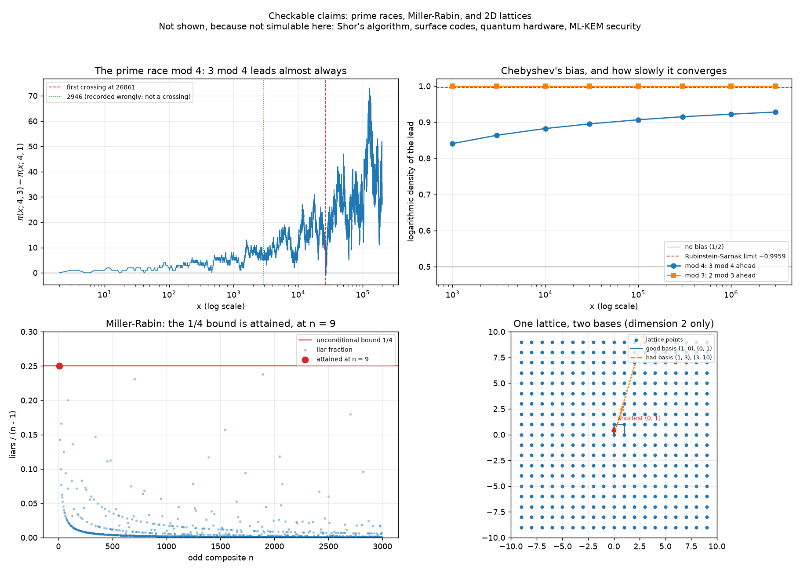

**Not simulated, and the document says why:** Shor's algorithm needs a quantum
computer; surface codes are a project in themselves; ML-KEM security is a
research-level conjecture. The lattice panel is dimension 2 *only*, and says so
in its title — there Gauss reduction solves SVP exactly, so it shows the
structural asymmetry and not the computational hardness. See
[`docs/number_theory_claims.md`](docs/number_theory_claims.md).

## The de Bruijn–Newman constant: RH restated as a threshold

`RH ⟺ Λ ≤ 0`. With `Λ ≥ 0` (Rodgers–Tao 2018) and `Λ ≤ 0.2` (Polymath15 2019),
the question becomes `RH ⟺ Λ = 0` inside the window `[0, 0.2]`.

So **`Λ ≤ 0` cannot be verified numerically** — it is the hypothesis restated,
and this repository says that rather than returning a number that looks like an
answer. What *is* available is the refutation direction: one non-real zero of
`H_t` with `t > 0` refutes RH outright, which makes this one of only two
refutation-capable framings in scope.

`H_t(z) = ∫₀^∞ e^{tu²}Φ(u)cos(zu)du` is built from the **sourced** definition
([Rodgers–Tao, arXiv:1801.05914](https://ar5iv.labs.arxiv.org/html/1801.05914)),
and checked two independent ways: `H_0` against `(1/8)ξ(1/2 + iz/2)` to `1e-14`,
and its first zero against `2γ₁ = 28.2694502834`. A first draft had three errors
from memory — the exponents, a missing `1/8`, and `ξ(1/2+iz)` instead of
`ξ(1/2+iz/2)` — and the check is what caught them.

```bash
python scripts/run_de_bruijn_newman_demo.py
```

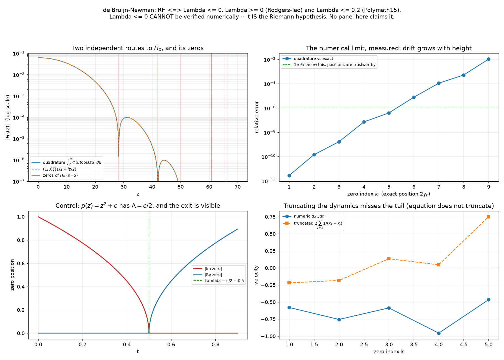

**Three limits, measured and pinned rather than hidden.** The low-zero scan
returns the same count for *every* `t` in `[−0.2, 0.2]` — that is
**insensitivity, not reassurance**: if `Λ < 0` the first exit happens at
Lehmer-pair heights. The quadrature drifts past `k ≈ 6` (`2.8e-12` at `k = 1`,
`1.1e-2` at `k = 9`). And the dynamics equation does not truncate — the numeric
`dx_k/dt` is ≈ `−0.6` for every zero while the truncated sum changes sign, which
is the signature of a missing tail. A control with `Λ = c/2` known by hand shows
what the machinery *would* detect if an exit were in range. See
[`docs/de_bruijn_newman.md`](docs/de_bruijn_newman.md).

## The physics dictionary: imaginary time and prime orbits

This repository already had both halves of the quantum-chaos picture — the
primon gas (`primon_gas.py`, where `Tr[e^{−sH}] = ζ(s)` exactly) and GUE spacing
statistics (`quantum_chaos.py`). Two pieces were genuinely absent, and they are
the *bridge* between those halves.

The pre-existing spacing-statistics figure, unchanged and not re-derived here:

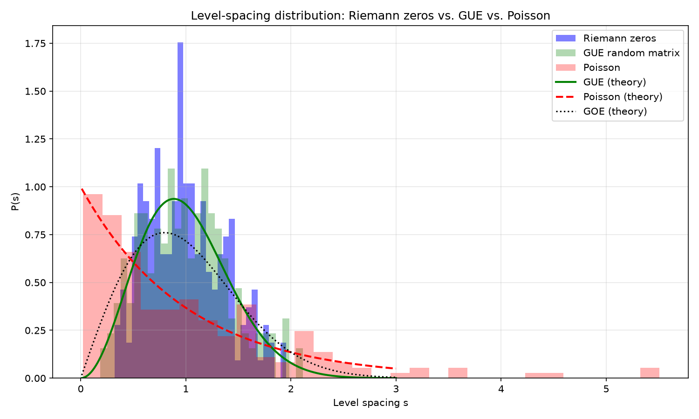

**Imaginary time.** The real-time trace `Tr[e^{−iHt}] = Σ n^{−it}` has
`|n^{−it}| = 1`, so its partial sums grow like `N`; the imaginary-time trace
`Σ n^{−τ} = ζ(τ)` converges for `τ > 1`. Measured: `|Σ_{n≤N} n^{−it}|/N` is
constant at `0.0766` across a 128-fold range of `N`, while the thermal error
falls `2.0e-3 → 1.6e-5`. **So the critical strip is exactly the continuation
problem.** Two corrections to the popular telling: `β = 1` is a **Hagedorn**
temperature (a *maximum*), not Bose–Einstein condensation (a minimum) — the state
count is `⌊e^E⌋` and the density ratio settles at `e`, measured `2.700…2.741`;
and the mechanism of the continuation is Jacobi's `θ(x) = x^{−1/2}θ(1/x)`,
verified to `1e-16`.

**Prime orbits.** The Gutzwiller dictionary is *exact at first order*:
`π(e^T) ~ e^T/T` is the Anosov prime orbit theorem with `h = 1` **forced** by the
periods being `log p`, not chosen. Ratios `1.175 → 1.132 → 1.100 → 1.078`. What
does not work is the error term: the truncated explicit formula's error
oscillates with **no downward trend** over `K ≤ 89` zeros, and resolving `ψ(X)`
needs on the order of `N(X)` of them — `138,068` at `X = 10⁵`, `3.9×10¹²` at
`X = 10¹²`. The dictionary *relocates* RH rather than approaching it.

```bash
python scripts/run_quantum_chaos_claims_demo.py
```

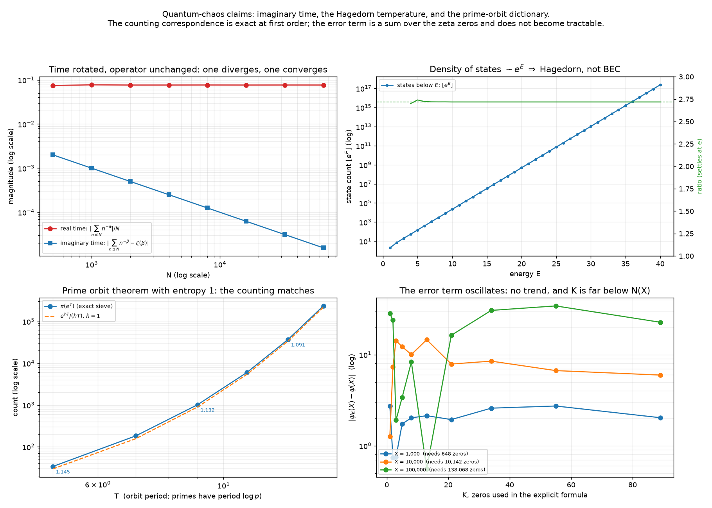

See [`docs/quantum_chaos_claims.md`](docs/quantum_chaos_claims.md), which also
records that the primon gas, GUE statistics and Berry–Keating were **already
here** and are not re-implemented.

## The Hilbert–Pólya prototype: an operator, and the four gaps

Berry–Keating (`H = xp`) was *documented* in `docs/research_notes.md` and
`docs/dimension_shift_quantum_chaos.md`, but no operator existed whose spectrum
could be computed and held against the zeros. This builds one and screens it.

The positive half is real. For `H = −i(x d/dx + 1/2)` on `L²(0,∞)` the formal
eigenfunctions are `x^{−1/2+iE}`, whose exponent is `s − 1` at `s = 1/2 + iE`:
**the critical line is the construction's fixed point, not a parameter.** Verified
in exact arithmetic — shifting the real part by `δ` shifts the residual by exactly
`|δ|`, so the check can fail.

The other half is four gaps, each measured rather than asserted:

| # | gap | measured |
|:--|:---|:---|
| 1 | no eigenvalue | `|ψ|² = x⁻¹` for every `E`, so `∫ = log(b/a)`: `13.816` at width `10⁶` and no limit at either end. The spectrum is all of `ℝ`, which contains the zeros **and every other real number** |
| 2 | the box is a picket fence | `r = 1.000` against `0.610`; rungs every `2.3652` while the zero spacings run `0.716…6.887`; a box fitted to hold 100 zeros by `γ₁₀₀` predicts `21` levels below `T = 50`, where there are `10` — **2.10×** |
| 3 | a real spectrum is free | `diag(any real list)` is self-adjoint, so spectral reality carries no arithmetic content. On the `PT` route reality is a *condition*: the exact threshold is `θ_c = arcsin(s/r) = π/6`, thirty degrees at `s/r = 1/2` |
| 4 | imaginary time is blind to `Re(s)` | `Z(β) = Σe^{−βE_n}` consumes ordinates only. Shift every zero to `0.6 + iγ` and `Z(0.5) = 8.837461×10⁻⁴` is **identical** — difference exactly `0`, not small |

Gap 4 is the one that constrains the popular framing. Wick rotation is a
*consequence* of spectral theory, not a route into it: it reads `Im(s)` and never
`Re(s)`, so it cannot distinguish the hypothesis from its negation. What is a
theorem — and is verified to `1.2×10⁻¹⁶` — is the temperature statement
`G(τ) = G(β − τ)`, with `β = 8πGM/c³` for a black hole (`T = 6.1687×10⁻⁸ K` at
one solar mass, `T·β·k_B/ħ = 1`).

```bash
python scripts/run_hilbert_polya_demo.py
```

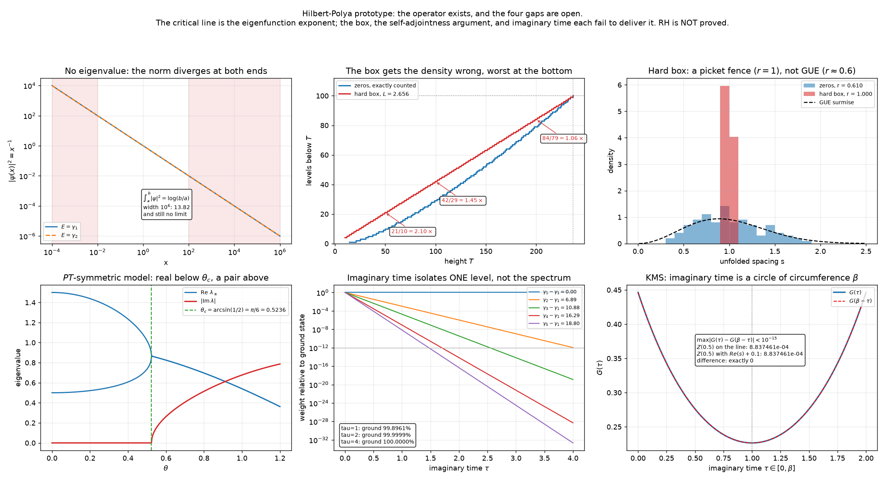

[`docs/hilbert_polya.md`](docs/hilbert_polya.md) also records four corrections to
the framing that prompted this: the "automatic proof" gap, the box claim, the
imaginary-time claim, and the attribution — the 2017 PRL is Bender, Brody and
**Müller**, not "Bender, Brody and Jones", and its claimed spectrum rests on
boundary conditions that later work disputes.

## Can a candidate be screened at all?

Having built one operator and measured four gaps, the next question is whether a
*candidate* can be screened. Three new constructions were built and put through
five criteria. The answer is negative in a way that matters.

**The prime-length quantum graph** is new here and is the literal realization of
the Gutzwiller dictionary: a star graph with edge lengths `(1/2) log p_j`, so the
round trip on edge `j` is `log p_j` and every closed path has length `log n` —
verified from the geometry for all 23 paths with `n ≤ 30`. It is self-adjoint by
construction (Kirchhoff at the vertex, Dirichlet at the ends), with one secular
equation `Σ_j cot(kℓ_j) = 0` and 150 levels below `k = 120`. Its counting
function is **linear**, `N/k = 1.250` against `L/π = 1.233`, and below
`k = γ₁` it has **20 levels where the zeros have 1**.

Then the uncomfortable part, which is the reason this track exists:

| object | mean `r` | KS to Wigner |
|:---|---:|---:|
| GUE reference | `0.599` | — |
| **prime-length graph** | **`0.641`** | **`0.0438`** |
| zeta zeros | `0.610` | `0.0579` |

An operator that provably is not the zeros fits the universal statistics **better
than the zeros do**. So `mean_r_ratio` and `ks_test_against` cannot certify a
candidate — and the DSH criterion S2 ("model statistics comparable to the zero
baseline") is nearly vacuous, which `docs/central_hypothesis.md` had already
warned about and which is now demonstrated.

**The unitary twin** makes the logical point: `U diag(γ) U†` passes every
numerical screen exactly — `max|E_n − γ_n| = 2×10⁻¹³`, `r = 0.610`, KS
`0.0579` — and proves nothing, because by the spectral theorem *every* operator
with these eigenvalues is unitarily equivalent to `diag(γ)`. The content of a
Hilbert–Pólya construction is therefore never the existence of such an operator;
it is that the operator is defined **without `zeta`** and its spectrum **proved**
to be the zeros.

**Density is a real constraint that is not yet a test.** `dN/dT = (1/2π)log(T/2π)`
is unbounded, so no Weyl power law can match it asymptotically — that rejects the
box and the graph in principle. But over the first 100 zeros a single power law
`T^1.436` reproduces the count to **1.33 levels in 100**, so at `T ≤ 236` the
obstruction is invisible. It is a requirement on a future construction, not a
screen of a present one.

```bash
python scripts/run_operator_candidates_demo.py
```

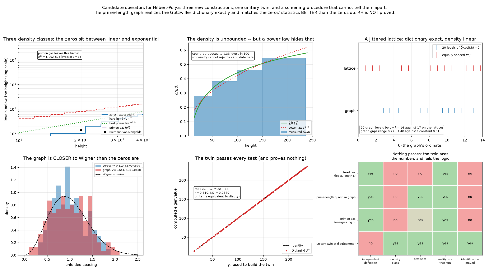

The screening table scores all four on five criteria and `survivors` returns the
empty list. [`docs/operator_candidates.md`](docs/operator_candidates.md) records
the numbers, the five-criterion checklist that replaces the four screens, and a
careful reading of [arXiv:2503.09644](https://arxiv.org/abs/2503.09644) — the
question that decides that construction is whether `H_M` is defined without
`zeta`, and what its counting function is, neither of which can be settled
numerically.

## RH over finite fields: the one case where a computation is a proof

This is the one place in the whole project where the Riemann hypothesis is a
**theorem** — and, more usefully, where a finite computation is a **proof**.

For a smooth projective curve `C` over `F_q`, `Z(C,T) = exp(Σ NₘTᵐ/m) =
P(T)/((1−T)(1−qT))` with `P(T) = Π(1−αᵢT) ∈ Z[T]`, and RH is `|αᵢ| = q^{1/2}`.
Because `P` has **integer** coefficients, this is decidable exactly: genus 1
reduces to `a² ≤ 4q`, and genus 2 to an integer test on
`S(w) = w² − a₁w + (a₂ − 2q)` from the palindromic structure. **No irrational is
ever evaluated.**

| curves certified | count | failures |
|:---|:---|:---|
| elliptic over `F₅ … F₁₉` | 942 | **0** |
| smooth genus-2 over `F₃` | 324 | **0** |
| smooth genus-2 over `F₅` | 10 000 | **0** |

The point counts also check the *structure*, not just the bound:
`Nₘ = qᵐ + 1 − Σαᵢᵐ` reproduces brute-force counts `12, 192, 2268` for
`y² = x³+1` over `F₁₃`. And the Hasse bound is **attained from both signs**
(`+10` at `m = 2` against a bound of exactly `10`; `−50` at `m = 4` against
`50`) — a bound never attained is not known to be sharp.

A sweep of **all** 729 tuples over `F₃` first reported **30 violations of a
theorem**. All 30 are singular or `deg f = 4`, i.e. outside the hypotheses;
among genuine smooth curves the count is zero. `is_smooth_genus2` now gates every
certificate. A screen that reports violations of a theorem is reporting a bug in
its *hypotheses* first.

```bash
python scripts/run_finite_field_curves_demo.py
```

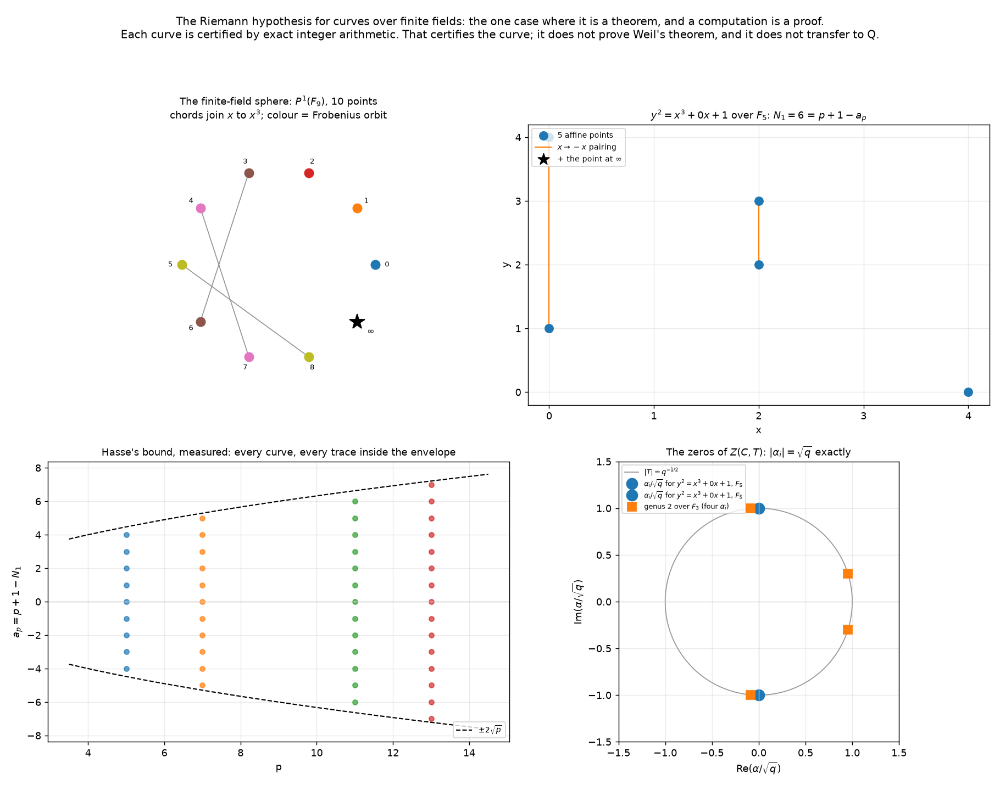

Panel 4 is the statement itself: the `αᵢ/√q` lie on the unit circle. **What this
does not do:** per-curve certificates do not prove Weil's theorem, which is
universal — and the theorem **does not transfer to `Q`**, because its proof runs
through the Frobenius action on étale cohomology and no analogue of that action
is known over `Q`. See [`docs/finite_field_curves.md`](docs/finite_field_curves.md).

## Numerical core

The foundation everyone else builds on:

- **`zeta.py` / `zeros.py`** — thin, careful `mpmath` wrappers for evaluating `ζ(s)` and locating/verifying non-trivial zeros to arbitrary precision.
- **`explicit_formula.py`** — the Riemann–von Mangoldt explicit formula linking sums over zeros to sums over prime powers, with regularization for numerical evaluation.
- **`spectral_density.py`** — diagnostics comparing a cumulative zero count against the Riemann–von Mangoldt asymptotic `N(T) ~ (T/2π)log(T/2πe)`.
- **`plots.py` / `generate_plots.py` / `test_plot.py`** — the plotting layer behind every figure in this README.

This layer makes no novel claims; it exists so every other track has a trustworthy ground truth to compare against.

## The dimension-shift programme

### The central hypothesis

Documented in full in `docs/central_hypothesis.md`. The **Dimension-Shift Hypothesis (DSH)** conjectures a family of self-adjoint Hamiltonians `H(λ)` on a `Z₂`-graded Hilbert space, together with a discrete involution `σ`, such that:

1. `[H(λ), σ] = 0` in the intended regime;
2. the spectral density of `H(λ)` matches the Riemann–von Mangoldt asymptotic;
3. a precisely defined spectral subsequence corresponds to the non-trivial zeta zeros;
4. a fixed-locus or positivity argument forces those zeros onto `Re(s) = 1/2`;
5. the local level statistics are GUE-like.

This is intentionally a stronger requirement than "the model looks chaotic" — GUE statistics alone are cheap and do not by themselves encode the Euler product or any individual zero.

### The prototype involution

On the complex plane the prototype is the reflection

```
σ(s) = 1 - conjugate(s),        σ(σ(s)) = s,        σ(s) = s  ⟺  Re(s) = 1/2
```

Run through the vetting pipeline (`affine_reduction.py`), this is honestly recorded as a **known affine map** — the functional-equation reflection composed with conjugation — not a new algebraic object:

```python
from riemann_framework.affine_reduction import check_affine_reduction

result = check_affine_reduction("1 - s_conj")
print(result.is_affine)      # True  -> a known affine map
print(result.coefficients)   # (0j, (-1+0j), (1+0j))  -> 0*s - 1*conj(s) + 1
```

Its fixed locus is nonetheless exactly the critical line, which is the property the wider programme actually needs; see `docs/dimension_shift_involution.md` §2.1 for the full discussion of why triviality as an algebraic object does not disqualify it as a *symmetry* to build a Hamiltonian around.

### Chaos models, statistics, and the falsification grid

- **`dimension_shift_chaos.py`** — a family of coupled Hamiltonians built around the sector-swap involution. **Corrected:** `[H, σ] = 0` is now *enforced* (`H = [[A, C], [C†, A]]`, so `‖[H,σ]‖/‖H‖ = 0` rather than `1.35…1.46`), the blocks can be GUE or GOE instead of only real symmetric, and the spectrum is split into its `σ = ±1` sectors. The sectors are `spec(A + C)` and `spec(A − C)` — verified numerically, not assumed.
- **`quantum_chaos.py` / `statistics.py`** — mean adjacent-gap ratio statistics (`⟨r⟩`), matched against Poisson (`≈0.386`), GOE (`≈0.531`), and GUE (`≈0.600`) reference values, with bootstrap confidence intervals.
- **`falsification_test.py`** — **rewritten.** The previous version ran one seed per point and declared "DSH is SUPPORTED" if any of 90 grid points landed in `[0.58, 0.62]`. At `2d = 20` the per-seed standard deviation is `0.075`, and **14% of pure GOE draws enter that window** (`23%` without unfolding), so the window was reachable by noise. The reported point (`0.6117`) has a 300-seed mean of `0.523 ± 0.069`. Now every point runs **300 seeds** and reports mean ± std, standard error, and the per-class breakdown; the verdict is one of `supported_multi_seed` / `goe_only` / `poisson_only` / `mixed` / `inconclusive`.

  **The corrected verdict is `mixed`, and "mixed" is not a success.** A `σ`-symmetric spectrum is a superposition of two sectors and lands at `0.369 … 0.429` — never GUE. A single sector reaches `0.594 … 0.609` **if and only if** the input blocks were GUE, i.e. the class is inherited, not produced. The specification's `std < 0.02` clause is also unreachable at these sizes (measured `0.084` at `2d = 20`, `0.026` at `2d = 200`), and is reported as such rather than redefined. See [`docs/lessons_learned.md`](docs/lessons_learned.md) §15.

Three documents carry the surrounding material: [`docs/chirality.md`](docs/chirality.md)
(mirror-closure is not achirality: 37 split / 40 inert primes below 400, lens
spaces below 200, the `χ₋₄` parity test, and Davenport–Heilbronn),
[`docs/pt_symmetric_hilbert_polya.md`](docs/pt_symmetric_hilbert_polya.md) (the
`σ` ↔ energy-level dictionary, with two corrections to its popular form), and
`chirality.py` / `dsin_sigma_symmetry.py` for the checks themselves.

### The corrected falsification verdict

The multi-seed grid (`output/falsification_summary.txt`, 300 seeds per point, 24
points) gives **`mixed`**, and mixed is not a success:

- the **full spectrum** of a `σ`-symmetric model is a superposition of its two
  sectors and lands at `⟨r⟩ ∈ [0.3689, 0.4287]` — never GUE. A whole-spectrum
  test is therefore asking the wrong question.
- a **single sector** lands at `[0.5927, 0.6092]` for GUE input blocks and
  `[0.5248, 0.5396]` for GOE ones. The class is *inherited, not produced*: 24 of
  48 sector means sit inside `[0.58, 0.62]`, and every one of them is in the GUE
  class, because GUE blocks were put in.
- the specification's `std < 0.02` clause is **unreachable at these sizes**: the
  per-seed std is `0.084` at `2d = 20`, `0.034` at `2d = 100` and `0.026` at
  `2d = 200`, shrinking like `1/√(2d)`. The clause is implemented as written, so
  `supported_multi_seed` is never earned; the standard error (`0.004` at 300
  seeds) is reported next to it rather than replacing it.
- per class the labels differ: `goe_only` for the real-symmetric construction
  (all sectors in `[0.51, 0.55]`), `mixed` for the complex-Hermitian one.

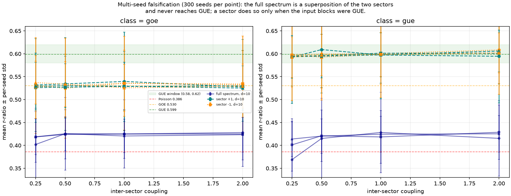

Details and the four defects in `docs/lessons_learned.md` §1.

### DSIN: a toy communication-channel simulation

**Verdict: the design is closed — not unproven, closed.** A single published
observable carries the bit, so the adversary's measurement is always the right one;
§4.1 of [`docs/dimension_shift_quantum_communication.md`](docs/dimension_shift_quantum_communication.md)
proves that no function of its statistic can bound her information. What survives is
an exact commutation result — a `σ`-commuting channel preserves `Fix(σ)` — which was
never a security statement. Verdict: [`docs/future_work.md`](docs/future_work.md) Priority 6.

| scenario (`n = 500`, seed 42) | BER | detection rate |
|:---|:---|:---|
| ideal channel | 0.0000 | 0.0000 |
| depolarizing `p = 0.1 / 0.3 / 0.5` | 0.044 / 0.168 / 0.252 | 0.104 / 0.332 / 0.502 |
| symmetry-breaking `ε = 0.1 / 0.5 / 1.0` | 0.010 / 0.260 / 0.404 | 1.000 / 1.000 / 1.000 |
| intercept-resend (mean of 5 seeds) | 0.4528 | 1.0000 |

## The BB84 implementation layer: what the protocol model cannot see

`bb84.py` models the BB84 *protocol* — one photon per round, perfect source, perfect detector. That protocol has been secure since Mayers (1996) and Shor–Preskill (2000), and no abstract attack will break it. The breaks that happened in practice happened one layer down, in hardware. `bb84_implementation.py` starts on that layer: the photon source, the detector model, and photon-number splitting.

**The source is not a single photon.** A weak coherent pulse is Poisson, so at `μ = 0.5` it is 61% vacuum, 30% single-photon and **9% multi-photon**. Eve measures the photon number without disturbing it, keeps one photon from each multi-photon pulse and forwards the rest. She then learns the bit when the basis is announced during sifting, and the photons she forwards are the state Alice prepared — so she adds **no errors at all**.

| `μ` | `Q_μ` | `E_μ` | fraction Eve holds |
|:---|:---|:---|:---|
| 0.1 | 0.009952 | 0.010098 | 0.0906 |
| 0.5 | 0.048772 | 0.010020 | 0.3782 |
| 1.0 | 0.095164 | 0.010010 | 0.6134 |
| 5.0 | 0.393471 | 0.010002 | **0.9914** |

`η = 0.1`, `e_det = 0.01`, `p_dark = 1e-6`. **The error rate is flat at `e_det` while Eve's information climbs past 0.99** — a detector watching the error rate sees a healthy channel at every point.

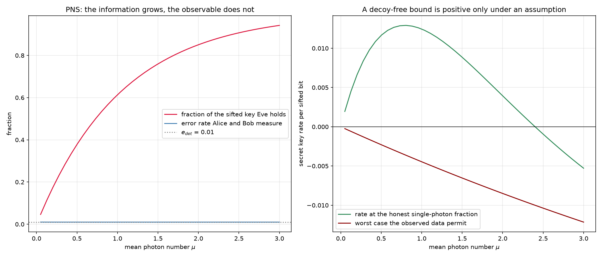

The consequence is a statement about what a bound *is*. The single-photon fraction `Q_1/Q_μ` that a GLLP rate needs is not determined by the observed data: Eve's blocking of single-photon pulses moves `Q_1` without moving `Q_μ` or `E_μ`. So a decoy-free implementation reports a positive rate computed at an assumed `Q_1/Q_μ` — about `+0.012` at `μ = 1` — while the worst case consistent with the data is negative. A bound that fails for an admissible channel is not a bound, and that gap is what decoy states close.

**What is not modelled, and is not claimed:** detector blinding, and timing and Trojan-horse channels. Both need detector and source physics rather than a correction to the accounting, and [`docs/bb84_implementation.md`](docs/bb84_implementation.md) says what each would need. **Decoy states and finite-key statistics are implemented.** The `Y_1` lower bound is read off Ma–Qi–Zhao–Lo (2005) rather than recalled: it is checked against the general two-decoy form at `ν₁ = 0`, and against the simulation's own true `Y_1` over 510 parameter sets with zero violations — valid and about 98% tight at `ν = 0.05`. Finite keys use Hoeffding's `δ = √(ln(1/ε)/2k)`, which falls as `1/√k` and imposes a minimum of `5.6e5` pulses at these parameters.

One expectation worth stating plainly, because a simulation environment invites the opposite: running attacks against `bb84.py` will not find a protocol-level gap, since the protocol is proven. The value is in retracing the accounting, not in trying to falsify it.

## Shift-zeta: a graded-algebra lift (negative result)

Full detail in `docs/shift_zeta_result.md`; this is the most rigorously negative result in the repository, and it is reported as such rather than downplayed.

**The question:** does lifting the Euler product into a `Z₂`-graded algebra `A = A₀ + ωA₁` (with `ω² = 1`, involution `σ(x) = ωxω`, and local factors `1/(1 - p^{-s}γ_τ)` where `γ_τ = ((1+τ)/2)I + ((1-τ)/2)ω`) force the zeros of the resulting "shift-zeta" into the fixed locus `Fix(σ) = A₀` (i.e. the critical line's algebraic analogue)?

**The answer: no.** Measured over 600 primes:

- The algebra is well-defined, and `σ` is a genuine algebra homomorphism (**G1, G2 pass**).
- The graded trace is `σ`-invariant; the supertrace is `σ`-*anti*-invariant — these are different, non-conflicting functionals (**G3, F5 both hold**).
- At `τ = 1` — the degenerate control case — the graded trace equals the classical Euler product term for term (relative error `5.1×10⁻⁴` at `s=2`, pure truncation) (**G7 passes**). This confirms the methodology is sound: the machinery *can* reproduce `ζ` exactly when it is supposed to.
- For `τ ≠ 1`, the trace departs from `ζ` by **11%–44%** at `s=2`, and the completion (functional-equation) symmetry fails with residuals of `10⁻²`–`10⁻¹`, three to ten orders of magnitude above the numerical noise floor of the `τ=1` control (**G5 fails**).
- Most decisively: at `τ=1`, where the trace is provably the classical product, it dips sharply and exactly at every classical zero — a positive control showing the diagnostic works. At `τ≠1`, the trace is instead **3.5×–7.5× larger** at those same heights, with no corresponding dip. The zero sets do not coincide (**G6 fails**, triggering falsification criterion **F1**).

**Why it fails, structurally:** every local factor in the graded product is a polynomial in a single element `γ_τ`, so the product never leaves the two-dimensional subalgebra `C[γ_τ]` — there is no interaction between different primes' contributions inside the grading. This is the concrete mechanism, not just an empirical shortfall, and it is the kind of obstruction the framework's own Stage-D arithmetic-coupling test is designed to catch in future proposals before months are spent on them.

No criterion failure here says anything about whether RH is true; it says this specific graded lift does not reproduce the classical zeros, and it explains why in terms that generalize to other naive lifts.

```powershell
python scripts/run_shift_zeta_analysis.py
```

The figures below are diagnostic, not evidence about zero locations; read the caveats in `scripts/run_shift_zeta_analysis.py` before drawing conclusions from them.

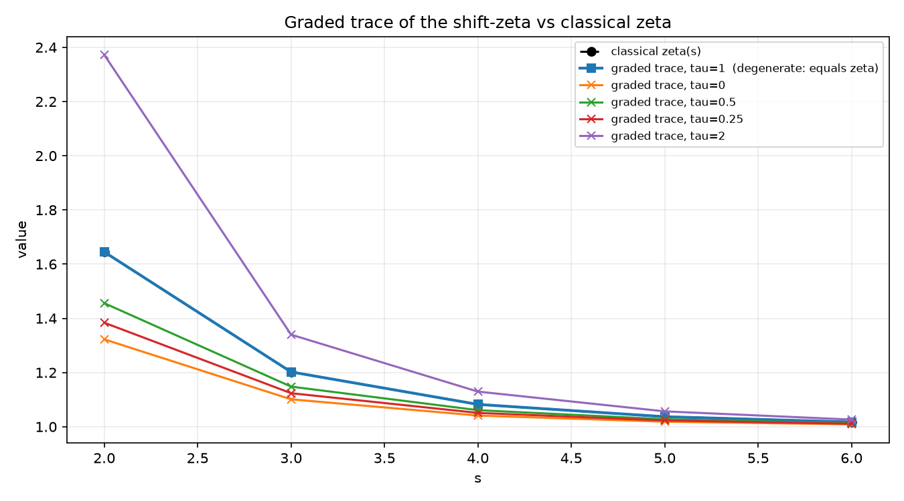

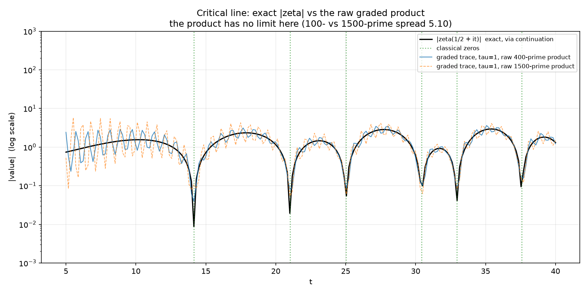

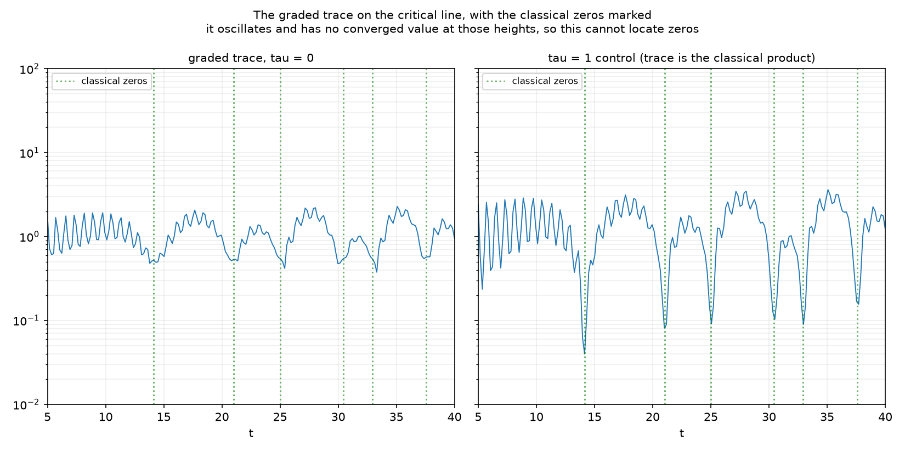

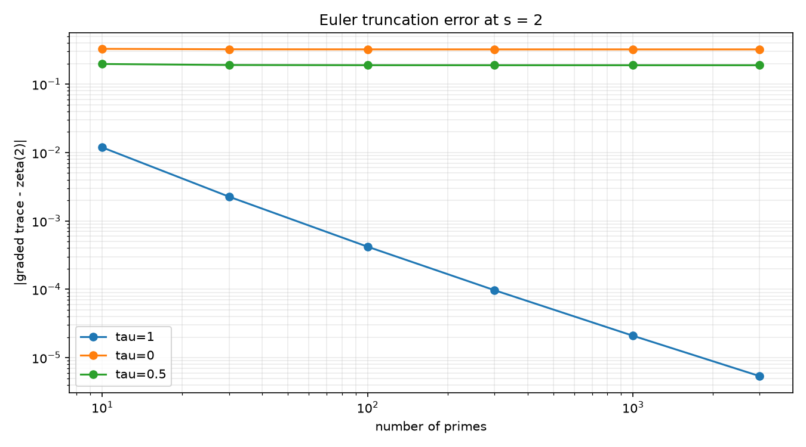

## The primon gas: an exact arithmetic anchor

The one place in this repository where the Euler product is not modeled or approximated but **provably present**, due to Julia (1990) and Spector (1990), refined into the Bost–Connes system (1995).

On `ℓ²(ℕ)` with orthonormal basis `|n⟩`, define the diagonal Hamiltonian

```
H|n⟩ = log(n)|n⟩
```

Then, exactly, for `Re(s) > 1`:

```
Tr[e^{-sH}] = Σ_n n^{-s} = ζ(s) = Π_p 1/(1 - p^{-s})
```

This falls directly out of unique prime factorization: `ℓ²(ℕ)` is the Fock space of independent bosonic oscillators, one per prime `p`, each with energy `log(p)`. `primon_gas.py` implements the finite truncation (`n = 1..N`) and confirms numerically that the truncated trace converges monotonically to `ζ(s)` as `N` grows:

```python
from riemann_framework.primon_gas import trace_convergence

result = trace_convergence(2.0, truncations=(10, 100, 1000, 10_000, 100_000))
print(result["relative_errors"])   # decreasing, ~0.6/N at s = 2
```

This gives candidate symmetries a genuine target instead of a merely statistical one: **does a proposed symmetry commute with the one operator whose trace is the Euler product?** `operator_symmetry.py` runs exactly this test and records a clean negative result: the natural lift of the dimension-shift involution onto `ℓ²(ℕ)` — a permutation swapping two primes' exponents in each integer's factorization — **provably cannot** commute with `H`, because `H` has strictly simple spectrum (`log` is injective on positive integers) and any operator commuting with a diagonal matrix of simple spectrum must itself be diagonal. This rules out an entire natural-looking family of symmetry proposals (basis permutations) in one linear-algebra fact, confirmed numerically at several truncation sizes to show the failure does not shrink with `N`.

**What this does not do:** the eigenvalues of `H` are `log(n)`, not the imaginary parts of the zeta zeros. This anchors the Euler product; it says nothing about the location of the zeros. Reaching the zeros requires the much harder, still partially open Connes (1999) adele-class-space construction — see `docs/central_hypothesis.md` §3 for the full discussion of what would still be needed.

### Why the Euler product is exact: the free commutative monoid

The sentence above — "this falls directly out of unique prime factorization" — is the claim `graded_prime_monoid.py` makes precise, because "falls directly out of" is exactly where a slogan tends to hide its content.

`(ℕ_{>0}, ×)` is the **free abelian monoid on the primes**, presented as the direct limit of `ℕ^k` under the "append one more coordinate" inclusions. Writing `φ(n)` for the exponent vector, the fundamental theorem of arithmetic says `φ` is a bijection. Two things follow.

**Exponent-vector addition is forced, not chosen.** If *any* operation `⋆` satisfies `φ(mn) = φ(m) ⋆ φ(n)`, then surjectivity of `φ` gives `v ⋆ w = φ(m) ⋆ φ(n) = φ(mn) = v + w`. Associativity, commutativity and an identity are *not* assumed — they are consequences. So "a number system whose dimension increases under multiplication", made precise, **is** unique factorization restated, and no alternative arithmetic was ever available to choose between.

**The factorization is the monoid structure.** The primon-gas energy is a linear functional of the exponent vector, `log n = Σ_p v_p(n) log p = ⟨λ, φ(n)⟩`, so the trace is a sum of a product over a free commutative monoid — which is a product of sums, i.e. the Euler product. The step that makes the grading by `ω` (distinct primes) give the Euler product rather than some other regrouping is the local factor `Σ_a q^{ω(p^a)} p^{−as} = 1 + q·p^{−s}/(1−p^{−s})`, which at `q = 1` is exactly `1/(1−p^{−s})`. `euler_product_from_grading` checks this by summing over the monoid and multiplying local factors separately — agreeing over 117649 exponent vectors — and the `q = 1` product climbs to `ζ(2)` as primes are added:

| prime limit | truncated Euler product | relative error |
|:---|:---|:---|
| 13 | 1.617917661314 | 1.64e-02 |
| 997 | 1.644725190239 | 1.27e-04 |
| 99991 | 1.644932747203 | 8.02e-07 |

`ζ(2) = 1.6449340668482264`.

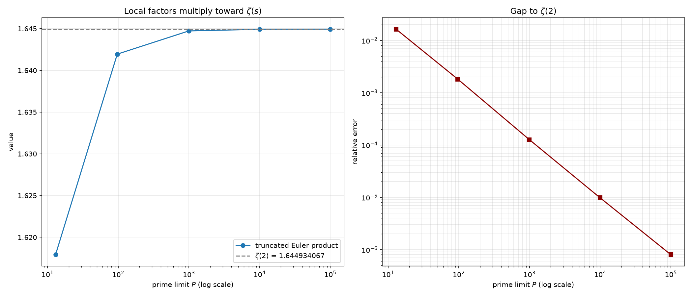

**The module's methods.** `graded_prime_monoid.py` exposes:

| function | what it does |
|:---|:---|
| `GradedPrimeNumber` | the element type: a frozen tuple of exponents, `*` as coordinatewise addition, `pad_to(k)` for the direct-limit inclusion, and equality by *trimmed* tuple so `(1,)` and `(1, 0)` are the same element while `(0, 0, 1, 1)` is correctly distinct from `(1, 1)` |
| `ONE` | the identity: dimension 0, the empty tuple, the integer 1 |
| `from_int(n)` / `.to_int()` | the isomorphism both ways. `from_int(35)` is `(0, 0, 1, 1)` — internal zeros are kept because they mark which prime each slot is, trailing zeros are padding |
| `dimension_of(n)` | `ω(n)`, the number of distinct primes: the "dimension" of the slogan |
| `dimension_tower(n, max_dim)` | the `1 → (1,0) → (1,0,0) → …` tower, every entry decoding back to `n`. Arithmetically inert on its own, and included so it can be contrasted with `*`, where the dimension change is not inert |
| `verify_monoid_isomorphism(n_max)` | brute force: `from_int(a) * from_int(b) == from_int(a*b)` on every pair up to `n_max`, plus the round trip `from_int(n).to_int() == n` |
| `candidate_rule_report(n_max)` | six plausible multiplication rules against unique factorisation, with the first pair where each breaks |
| `bridge_to_primon_gas(n_max)` | regroups `Σ n^{−s}` by dimension and **checks** the total against `primon_gas.trace_exp` rather than describing the comparison |
| `euler_product_from_grading(...)` | sums `q^{ω(v)}` over the exponent-vector monoid and multiplies one local factor per prime separately, then compares the two |
| `truncated_euler_product(s, prime_limit)` | `∏_{p≤P} 1/(1 − p^{−s})`, uncapped and cheap — the reference the graded sum approaches as the degree cap is raised |

**The rules that are not the rule.** `candidate_rule_report` puts the rivals on the table, because "addition is forced" is easier to believe with them there. At `n_max = 200`, in 0.28s:

| rule | what it is | first failure | required | produced |
|:---|:---|:---|:---|:---|
| `multiplication` | coordinatewise addition of exponents | — | — | — |
| `concatenate_prime_factors` | glue the two lists of prime factors | — | — | — |
| `exponent_max` | keep the larger exponent at each prime | `2 × 2` | 4 | 2 |
| `exponent_product` | multiply the exponents at each prime | `1 × 2` | 2 | 1 |
| `support_union` | union of supports, exponent 1 | `1 × 4` | 4 | 2 |
| `exponent_xor` | xor the exponents at each prime | `2 × 2` | 4 | 1 |

The second row is the finding, and it is not a rival. Gluing the two lists of prime factors is the literal "the dimension grows" reading, and it agrees with unique factorisation on all 40000 pairs — because recounting the glued list *is* exponent addition. The slogan and the algebra are one statement, not two competing ones. The legend is implemented by expanding to prime lists and recounting, a different code path from `a × b`, so the agreement is worth something.

The illustration is not the proof. The proof is the surjectivity argument above, and no finite enumeration could replace it; what the table adds is concreteness. `candidate_rule_report` refuses `n_max < 4`, since below that the rivals' smallest counterexamples (`2 × 2` and `1 × 4`) fall outside the loop and a rule would be reported as holding without having been tested where it fails.

[`docs/graded_prime_monoid.md`](docs/graded_prime_monoid.md) carries the theorem, the three inequivalent notions of "dimension" the slogan can mean — only `Ω` is additive; `ω` is subadditive and exact on coprime factors; the ambient length is a `max` — the rival-rule section, and the honest scope. This is a precise statement of ordinary arithmetic. It is not a new number system and it does not touch the zeros.

## Cayley-Dickson and the four-square theorem: does dimension-lifting create an Euler product?

This track directly tests an intuition: since extending `ℝ` to `ℂ` (via `i`) unlocked new structure, could repeating that doubling — circle → sphere → higher-dimensional sphere — produce something with genuine arithmetic content?

**`cayley_dickson.py`** implements the actual doubling construction `ℝ → ℂ → ℍ → 𝕆 → sedenions → ...` at any power-of-two dimension, and numerically confirms, rather than merely cites, the **Hurwitz theorem (1898)**: a normed division algebra over `ℝ` exists only at dimensions 1, 2, 4, and 8.

| Step | Dimension | Property lost |
|:---|:---:|:---|
| `ℝ → ℂ` | 2 | Total order |
| `ℂ → ℍ` | 4 | Commutativity |
| `ℍ → 𝕆` | 8 | Associativity |
| `𝕆 → sedenions` | 16 | Zero-divisor freedom (no longer a division algebra at all) |

Each collapse is demonstrated directly — for the sedenions, by an explicit constructed pair of non-zero elements whose product is (numerically) zero — not asserted from the literature.

**`four_squares.py`** then tests the harder, genuinely useful question: does the lift from 2D (Gaussian integers) to 4D (Lipschitz/Hurwitz quaternions) produce real Euler-product content? **Yes, concretely:** Jacobi's four-square theorem (1834), `r₄(n) = 8·Σ_{d|n, 4∤d} d`, verified here both by brute-force lattice-point counting on the 4-sphere and by formula, yields the genuine Dirichlet-series identity

```
Σ_n σ(n)/n^s = ζ(s)·ζ(s-1)
```

confirmed numerically against `mpmath.zeta` to a relative error of `~1.7×10⁻⁵` at `s=3` with 50,000 terms.

**The honest limit**, recorded in `ideas/dimension_lift_euler_product.yaml`: `ζ(s)·ζ(s-1)` is built from ordinary `ζ` evaluated at two separate points — it is not a new function whose own zeros need to sit on any critical line, and it says nothing about where `ζ`'s zeros are. The dimension-lift intuition is validated as producing real arithmetic content at this specific instance; turning that into something that *constrains* `ζ`'s own zeros remains the open, and much harder, part — exactly the gap that has kept every operator-theoretic RH programme, including this one, from closing since Hilbert and Pólya first proposed the idea around 1910–1915.

## Lean 4 formalization

Everything under `lean/` is compiled by [`lean_runner.py`](python/riemann_framework/lean_runner.py)
as part of the test suite, so formal claims cannot silently rot out of sync with the code.

The external quasi-Riemann manuscripts and their upstream Lean verification
artifacts are catalogued separately in
[`docs/openai_math_quasi_riemann.md`](docs/openai_math_quasi_riemann.md).
They are not part of this library's build or proof claims.

**Sorry-free — genuinely machine-verified:**

- **`RiemannFramework.lean`** — the aggregate library root. It imports only the sorry-free
  modules below, so `lake build --wfail` stays green.
- **`RiemannFramework/DimensionShift.lean`** — proves the sector-swap map is an involution.
- **`RiemannFramework/InvolutionEigenspace.lean`** — eigenspace lemmas for that involution.
- **`RiemannFramework/ZetaBridge.lean`** — owns the reflection `σ(s) = 1 - conj s` and bridges it to
  Mathlib's functional equation, with a machine-checked negative result. It derives `σ`-invariance
  of the zero set (`ζ s = 0 → ζ (σ s) = 0`) from `Λ(1 - s) = Λ(s)` composed with
  `ζ(conj s) = conj (ζ s)`, which also closes the classical quadruple symmetry
  `{ρ, 1 - ρ, conj ρ, 1 - conj ρ}`; proves the zero symmetries as *equivalences*
  (`riemannZeta_zero_iff_one_sub`, `riemannZeta_zero_iff_sigma`), which needs the
  functional-equation prefactor to be non-zero on the strip
  (`cos_pi_mul_div_two_ne_zero`, `riemannZeta_one_sub_prefactor_ne_zero`); proves the fixed locus
  of `σ` is exactly the critical line; observes that an involution partitions a set into orbits of
  size 1 or 2, a 2-cycle here being a pair of distinct zeros at the same height whose real parts
  sum to 1; proves `fixed_on_zeros ⟺ there are no 2-cycles ⟺ RH`; and finally proves that the
  implication "invariance ⟹ fixedness" is *itself equivalent to RH*. So the functional equation
  supplies the symmetry but not the absence of 2-cycles — the verdict is that it cannot discharge
  the wall. All 31 declarations are `sorry`-free.

**Statements of the target — every one still contains `sorry`, because the problem is open:**

- **`RiemannFramework/RiemannHypothesis.lean`** — a minimal RH statement over Mathlib's `riemannZeta`.
- **`RiemannFramework/RiemannHypothesis_optimized.lean`** — the Clay Millennium formulation
  (namespace `Millennium`): `ClayRiemannHypothesis` is proved equivalent to Mathlib's
  `_root_.RiemannHypothesis` and to the real-part and Riemann `ξ(t)` wordings. This file is a
  derivative work — see [`THIRD_PARTY_NOTICES`](THIRD_PARTY_NOTICES).
- **`RiemannFramework/ZetaConjecture.lean`** — the framework's own reduction: `RiemannHypothesisStatement`,
  `rh_of_zeros_fixed_by_sigma`, and the single open obligation `zeros_are_fixed_by_sigma`, which
  `prove_rh_via_sigma` consumes. This is the one place in the formalization where the open problem
  is written down.
- **`RiemannFramework/SanityChecks.lean`** — worked examples confirming `σ` behaves as expected.

**The pipeline interface:**

- **`RiemannFramework/NewIdeaTest.lean`** — defines `RHIdea`, the three obligations a candidate
  operator must discharge: that it is an involution, that its fixed points lie on the critical
  line (`eval_re`), and that every nontrivial zero is fixed by it (`fixed_on_zeros` — the wall).
  `RHIdea.riemannHypothesisStatement` proves those obligations are *sufficient* for RH, so the
  wall is exactly where a candidate is filtered out. The file registers `myNewOperator := 1 - conj s`
  and discharges the first two; the third is `sorry`, because it is the open problem. What is
  machine-checked is the implication plus obligations 1–2 — the pipeline is sound, not complete.

This is a first, small, genuinely formally verified result — not a formalization of RH, and the
repository does not claim otherwise. The suite pins both directions: `test_rh_statement_stays_open`
asserts that each RH-target file still reports `sorry`, so an accidental "RH is proved" claim fails
the build rather than quietly editing the README; and `test_sorry_free_file_is_complete` asserts
that the files listed as verified above really are `sorry`- and `axiom`-free.

## What this framework can and cannot validate

**What it can do.** It runs a candidate idea through stages A–D2 (see [The idea-vetting pipeline](#the-idea-vetting-pipeline)) and tells you how far it gets before hitting a known limitation. This is valuable as a **filter against self-deception** — it stops you from spending months on an idea that is actually just a renamed reflection.

**What it cannot do.** It can never confirm that something is a proof of the Riemann hypothesis **over `ℚ`** — and for a structural reason, not a limitation we could simply fix.

The distinction that actually matters is **finite versus universal**, not evidence versus proof. Where a claim is finite, a computation with a certificate *is* a proof of it, and this repository does that twice:

- `prime_certificate.py` proves that `p₁₀₀₀₀₀₀ = 15485863` and that none of the first million is missing.
- `finite_field_curves.py` proves the Riemann hypothesis for individual curves over finite fields, by exact integer arithmetic: 942 elliptic curves over `F₅…F₁₉`, 324 smooth genus-2 over `F₃`, 10 000 over `F₅`, with zero failures. `P(T)` has integer coefficients, so `|αᵢ| = √q` reduces to `a² ≤ 4q` for genus 1 and to an integer test on `S(w)` for genus 2, and **no irrational is ever evaluated**.

Neither is a numerical sample, and neither is a search that failed to find a counterexample. Both are finite claims decided exactly.

The Riemann hypothesis over `ℚ` is **universal** — it quantifies over all zeros — and no finite computation establishes a universal statement. For that, the framework's tests remain heuristic: a test not falsified at `N = 100,000` is never a proof for all `N`, and an idea clearing every stage A–E earns only "this idea has none of the known pitfalls we know how to check for."

There is a second reason the finite-field success does not help, and it is worth stating plainly: that proof runs through the **Frobenius action on étale cohomology**, and no analogue of that action is known over `ℚ`. The one case where RH is a theorem is the case whose proof has no known counterpart for `ζ`. See [`docs/finite_field_curves.md`](docs/finite_field_curves.md).

A third reason is logical and has nothing to do with `ℚ`, so it applies to the Hilbert–Pólya programme directly: **self-adjointness gives reality, not identification.** `diag` of any list of real numbers is a self-adjoint operator, so "there is a self-adjoint operator whose spectrum is real" is true of *every* real list, and a finite match of eigenvalues to zeros is a tautology with `n` numbers in it. What the conjecture needs is an operator **defined without reference to the zeros** whose spectrum is provably theirs, infinitely many of them. That is the gap the Hilbert–Pólya prototype above measures rather than closes.

The only route here to a machine-checked **universal** proof is Lean 4 — `DimensionShift.lean` and `InvolutionEigenspace.lean` are genuine, machine-verified proofs, but only of small helper lemmas, not of RH itself. An actual proof of RH over `ℚ` would have to be **fully formalized in Lean** — every step, every definition, all the way down to Mathlib's axioms — and would then be accepted or rejected by Lean itself, not by this framework. That is an order of magnitude more work than everything currently in `lean/`, and no one in the world has even begun this for RH (formalizing a century-old open problem is a multi-year undertaking even once a proof exists — see Kevin Buzzard's initiative to formalize Fermat's Last Theorem).

**If you genuinely believe you have found something.** Should an idea clear every stage and look mathematically watertight to you:

1. **Don't trust the framework — trust people.** Post the concrete mathematical claim (not the code) on MathOverflow or an appropriate specialist forum and ask for counterexamples.
2. **Check whether it has already been refuted.** The history of RH is full of promising-looking approaches that fail at a subtle point — often exactly at the Euler-product coupling, as we have seen repeatedly in this repository's own negative results.
3. **Only then think about formalization** — and even then, the path through Lean/Mathlib is years, not weeks.

**Honest advice, without wanting to take away your motivation:** this framework is an excellent tool for quickly discarding bad ideas and sharpening promising ones. But it is — and structurally can never be more than — a pre-filter. Confirmation of a real proof does not happen through code that prints "PASS"; it happens through human expert scrutiny and, ideally, full formal verification.

## Roadmap

**What is done.** Nine tracks, each with a document: the numerical core
(`docs/verification.md`), the Davenport–Heilbronn filter (`docs/dh_filter.md`), the
zeta-containment screen (`docs/zeta_factors.md`), the physics dictionary
(`docs/quantum_chaos_claims.md`, `docs/pt_symmetric_hilbert_polya.md`), the
finite-field theorem (`docs/finite_field_curves.md`), the de Bruijn–Newman
restatement (`docs/de_bruijn_newman.md`), the screening of operator candidates
(`docs/operator_candidates.md`), the DSH programme with its corrected verdict
(`docs/central_hypothesis.md`, `docs/lessons_learned.md` §1), and the DSIN/BB84
communication layer (`docs/dimension_shift_quantum_communication.md`,
`docs/bb84_implementation.md`).

**What is open.** The Lean formalization of RH (statements exist, all `sorry`); the
DSH sector question; the BB84 implementation layer (detector blinding, timing side
channels); and a size-aware replacement for the unreachable `std < 0.02` clause.

| milestone | success criterion (measurable) | status |
|:---|:---|:---|
| M1 multi-seed verdict | verdict written with `n_seeds ≥ 300`, `std`, and the parameter point | **done** — `mixed`, 300 seeds, in `output/falsification_summary.txt` |
| M2 consolidated negative results | nine sections, each carrying a measurement | **done** — `docs/lessons_learned.md` §1–§9 |
| M3 BB84 detector blinding | a blinding model whose measured success rate is reported, with a countermeasure | open, week 8 |
| M4 Lean `σ² = id` | sorry-free proof checked by `lake build` | open, week 10 |
| M5 DSH sector question | a definitive answer: a sector in `[0.58, 0.62]` with per-seed `std < 0.02`, or a proof that the construction cannot produce one | open, week 12 |

**What would falsify the project.** The DSH is abandoned if either holds:
(1) at every `d ≥ 100` and every coupling, each `σ`-sector's mean `⟨r⟩` stays inside
the GOE window `[0.51, 0.55]` once 300 seeds are used — i.e. the construction is GOE
by structure and cannot carry the zeros' class; or (2) the sector class is shown to
be inherited under every admissible choice of input blocks, so that any GUE result
is an assumption rather than a consequence. Criterion (2) is already the current
reading of the evidence; (1) is what M5 would settle.

## Test suite

From `python/`:

```powershell
python -m pytest tests/ -q
```

**1013 tests pass** on the current tree. They are not smoke tests: the suite
contains the negative results themselves, a regression test for every bug that
has been corrected here, and assertions that the Lean development has not
silently changed meaning.

| Test file | Tests | What it pins down |
|:---|:---|:---|
| `test_graded_algebra.py` | 197 | Graded algebra and shift-zeta criteria G1–G7 |
| `test_graded_algebra_even_odd.py` | 51 | Even/odd interface regressions |
| `test_primon_gas.py` | 32 | Exact trace identity, and the failed prime-swap lift |
| `test_graded_prime_monoid.py` | 52 | The monoid identification, the isomorphism check, the rival rules, the bridge, and the Euler factorisation |
| `test_dsin.py` | 34 | DSIN simulation and the BB84 baseline |
| `test_bb84_implementation.py` | 45 | Source, detectors, PNS, decoy bounds, finite keys |
| `test_bb84.py` | 31 | The BB84 baseline, and exact equivalence between its two backends |
| `test_proportion_certificates.py` | 20 | The checkable certificates behind two recent proportion theorems |
| `test_dh_filter.py` | 41 | Davenport–Heilbronn calibration, inventory integrity, and verdict precedence |
| `test_prime_certificate.py` | 51 | Sieve invariants, deterministic primality, and the certified millionth prime |
| `test_zeta_factors.py` | 37 | The two number-field factorizations, the bound regression, and the containment verdicts |
| `test_prime_races.py` | 18 | The prime race, Chebyshev's bias, and the `2946` regression |
| `test_miller_rabin.py` | 14 | The liar bound, Carmichael numbers, and the GRH base count |
| `test_lattice_reduction.py` | 17 | 2D reduction, SVP/CVP, and good-vs-bad bases |
| `test_de_bruijn_newman.py` | 18 | `H_0` against the sourced reference, `2γ_k`, and the three limits |
| `test_imaginary_time.py` | 14 | The two traces, Hagedorn, and Jacobi's theta identity |
| `test_prime_orbits.py` | 17 | Orbit counting, `h = 1`, and the measured error-term limit |
| `test_hilbert_polya.py` | 40 | The operator, the picket-fence failure, the `PT` threshold, and the thermal blindness |
| `test_operator_candidates.py` | 33 | The prime-length graph, the statistics trap, the twin, and the screening table |
| `test_finite_field_curves.py` | 30 | Field axioms, exact Hasse certificates, and the smoothness hypotheses |
| `test_mpmath_stub.py` | 13 | Stub coverage and well-formedness, both driven into failing |
| `test_documentation_sync.py` | 16 | README test counts, paths, figures and links against live artefacts |
| `test_affine_reduction.py` | 22 | The affine-reduction gate |
| `test_dimension_lift.py` | 17 | Dimension-lift Euler-product checks |
| `test_idea_pipeline.py` | 25 | Pipeline stages A–E, the Stage-D probe, and the inconclusive-gate contract |
| `test_formal_proof.py` | 15 | Every Lean module compiles; sorry-free files stay sorry-free; RH targets stay open |
| `test_dimension_shift.py` | 14 | Dimension-shift operator model |
| `test_falsification.py` | 24 | Multi-seed verdicts, the seed floor, and the single-seed artefact |
| `test_explicit_formula.py` | 11 | Explicit-formula calculations |
| `test_cayley_dickson.py` | 6 | Cayley–Dickson property checks |
| `test_dimension_shift_chaos.py` | 17 | `sigma` enforced, both symmetry classes, the sector split |
| `test_chirality.py` | 19 | Gaussian splitting, lens achirality, `chi_-4` parity, Davenport–Heilbronn |
| `test_dsin_sigma_symmetry.py` | 12 | Parity sectors, conservation, and the blind meter |
| `test_four_squares.py` | 4 | Jacobi four-square checks |
| `test_quantum_chaos.py` | 4 | Zero-spacing statistics |
| `test_numeric_zeros.py` | 2 | Numerical zero verification |

Three of these exist specifically to stop a claim from drifting away from the
evidence, and all three are enforced rather than documented:

- `test_formal_proof.py::test_rh_statement_stays_open` fails if any file stating
  the Riemann Hypothesis stops reporting `sorry` — an accidental "RH is proved"
  claim breaks the build instead of quietly editing this README.
- `test_formal_proof.py::test_sorry_free_file_is_complete` fails if a file listed
  as verified starts containing a `sorry` or an `axiom`.
- `test_formal_proof.py::test_lean_file_lists_are_current` fails if a module is
  renamed or deleted without updating the lists, so the failure names the real
  problem instead of surfacing as an opaque Lean object-file error.

## Generated Results

Plots are generated locally and are not required source files. From the
repository root, run:

```powershell
python python/riemann_framework/test_plot.py
python scripts/run_dimension_shift_chaos.py
python scripts/run_falsification.py
python scripts/run_dsin_verification.py
```

The scripts write PNG files to `output/`, including zero plots,
explicit-formula plots, spectrum comparisons, coupling sweeps, symmetry-breaking
sweeps, the falsification grid, and the DSIN/BB84 comparison. The current plot
snapshots are included below.

### Non-trivial zeros in the complex plane

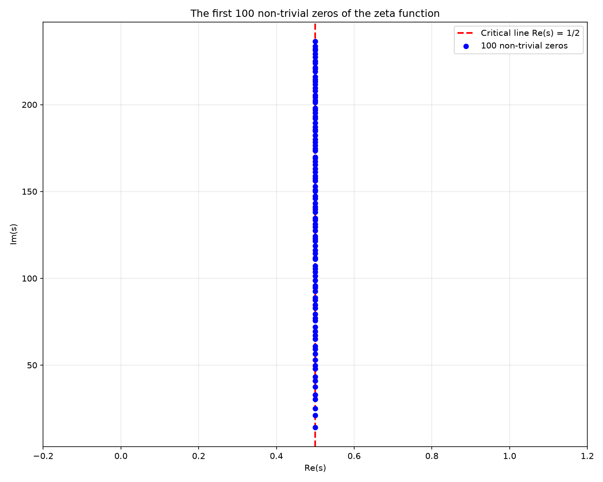

### Explicit formula approximation

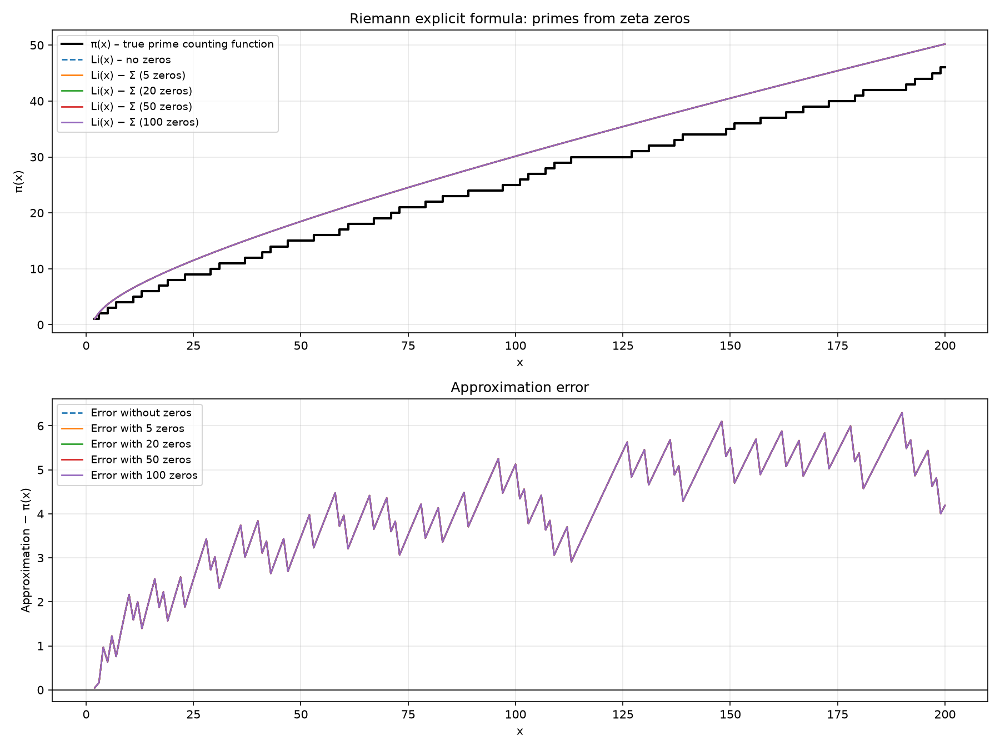

### Dimension-shift spectrum comparison

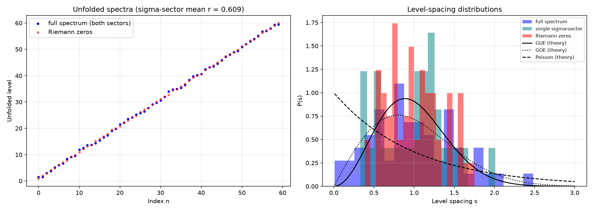

### Dimension-shift coupling sweep

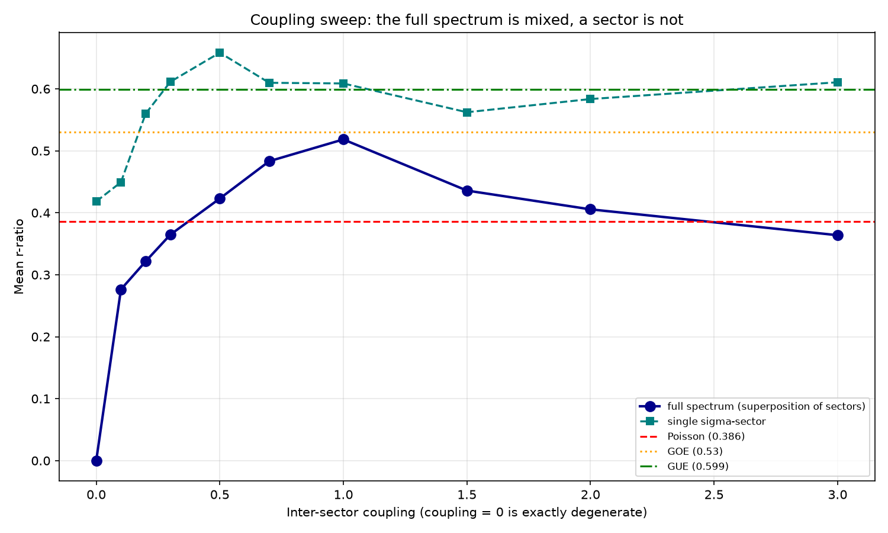

### Dimension-shift symmetry-breaking sweep

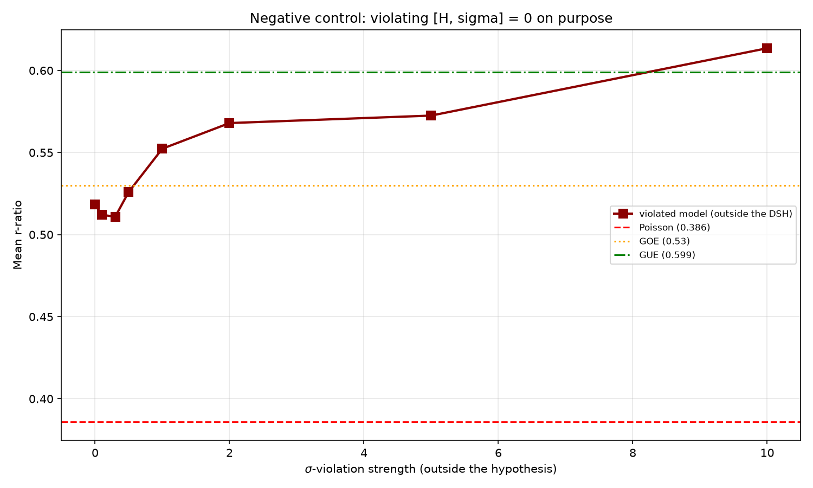

### Dimension-shift falsification grid

The falsification test scans a grid of dimension-shift parameters and reports
each point's mean adjacent-gap ratio `r`, then compares it with matched
Poisson, GOE, GUE, and Riemann reference systems.

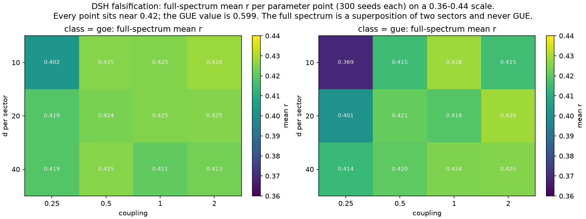

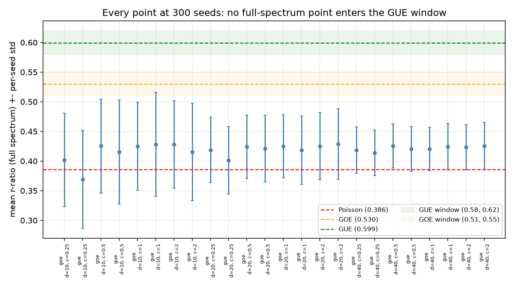

The heatmap shows mean `r` for every combination of sector dimension,
coupling, and symmetry breaking; the histogram shows how those 90 parameter
points distribute relative to the reference values (dashed lines). Both are
written by `scripts/run_falsification.py`, which also records the run in
[`output/falsification_summary.txt`](output/falsification_summary.txt).

### DSIN: BER under three noise models

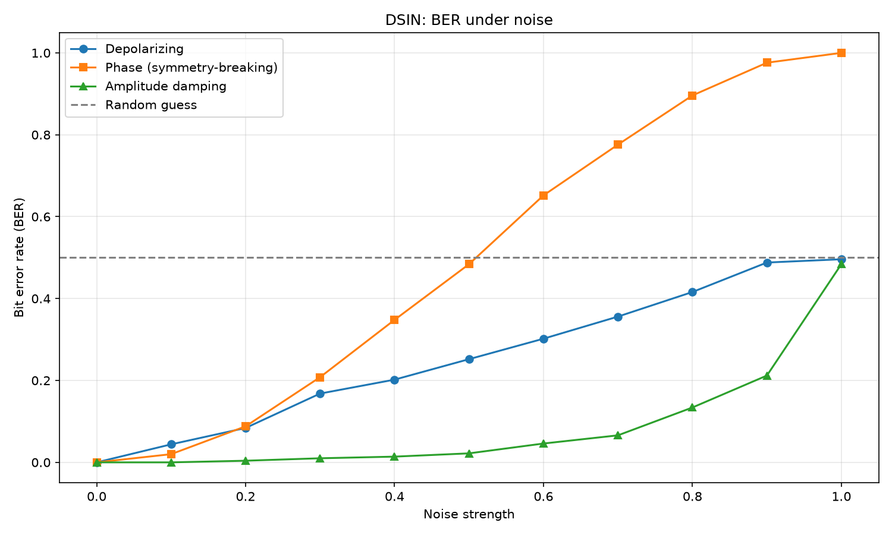

Depolarizing and amplitude noise produce a roughly linear rise in BER; phase
noise is the symmetry-breaking one and is shown against the same axis. The
dashed line is a random guess.

### DSIN: BER and detection under a symmetry-breaking attack

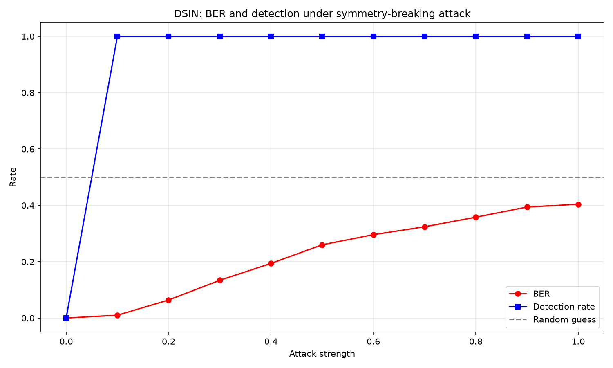

BER grows with the attack strength `ε`, while the detection rate stays pinned at
1.000: the detector reports whether the symmetry was broken, not how badly. The
third curve is the graded statistic `|1 − |⟨σ⟩||` — the detector's input before
thresholding — and it shows that the flat detection rate is the threshold's
doing, not the observable's. It is also the curve that sits at `2.22e-16` both
for a channel with no eavesdropper and for one being measured by an adversary,
which is why §4.1 of
[`docs/dimension_shift_quantum_communication.md`](docs/dimension_shift_quantum_communication.md)
can state that no function of it bounds the leakage.

### DSIN versus BB84

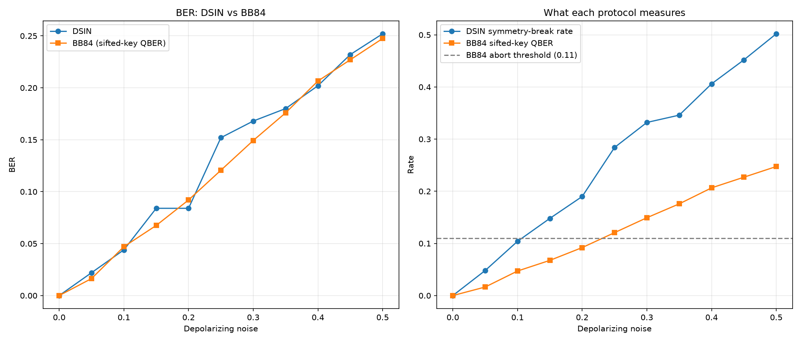

The right-hand panel deliberately plots DSIN's per-round detection rate against
BB84's *sifted-key error rate* — the quantity BB84 actually thresholds — rather
than BB84's 0/1 verdict, because the two protocols do not detect eavesdropping
the same way. Reading them as the same kind of number would be a mistake.

### DSIN: the channel commutes with the involution

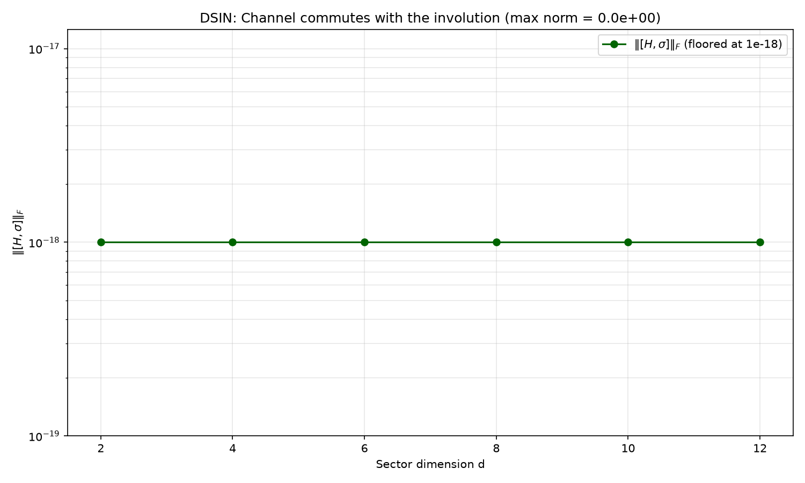

The commutator norms are exactly `0.0` at machine precision for every dimension
up to `d = 12`, which a log axis cannot render; they are therefore plotted
against a stated floor. If the construction ever stopped commuting, the curve
would lift off the floor immediately.

## Project Structure

```
riemann-framework/
│
├── README.md                     # Main documentation
├── LICENSE                       # GPL-3.0
├── THIRD_PARTY_NOTICES           # Apache 2.0 attribution (LeanMillenniumPrizeProblems)
├── .gitignore                    # Exclude Python, Lean, VS Code artifacts
├── pyrightconfig.json            # Type-checker config (extraPaths + mpmath stub)
├── lakefile.toml                 # Lean 4 project definition
├── lake-manifest.json            # Lean dependency manifest (mathlib pin)
├── lean-toolchain                # Lean version pin (e.g. leanprover/lean4:v4.x.x)
│
├── lean/                         # Lean 4 formalization
│   ├── RiemannFramework.lean         # Aggregate module (library root, sorry-free only)
│   └── RiemannFramework/
│       ├── DimensionShift.lean       # Sector swap is an involution (sorry-free)
│       ├── InvolutionEigenspace.lean # Involution eigenspace lemmas (sorry-free)
│       ├── ZetaBridge.lean           # σ, FE bridge, 2-cycle gap, verdict (sorry-free)
│       ├── RiemannHypothesis.lean       # Minimal RH statement (`sorry`)
│       ├── RiemannHypothesis_optimized.lean # Clay Millennium formulation (`sorry`)
│       ├── ZetaConjecture.lean          # RH statement + the open `zeros_are_fixed_by_sigma` (`sorry`)
│       ├── NewIdeaTest.lean             # `RHIdea` pipeline interface + demo (`sorry`)
│       └── SanityChecks.lean            # Worked examples for σ
│
├── python/                       # Numerical tests and control logic
│   ├── pyproject.toml            # Project definition (uv/pip)
│   ├── requirements.txt          # numpy, matplotlib, mpmath, pytest
│   │
│   ├── riemann_framework/        # Python package
│   │   ├── zeta.py               # mpmath wrapper for ζ(s)
│   │   ├── zeros.py              # Computation / verification of zeros
│   │   ├── explicit_formula.py   # Riemann explicit formula
│   │   ├── dimension_shift.py    # Dimension-shift operator model
│   │   ├── dimension_shift_chaos.py # Hamiltonian chaos experiments
│   │   ├── quantum_chaos.py       # Zero-spacing statistics
│   │   ├── dsin.py                # DSIN communication simulation
│   │   ├── bb84.py                # BB84 baseline, for comparison with DSIN
│   │   ├── bb84_implementation.py # Source, detectors, PNS (implementation layer)
│   │   ├── statistics.py          # Spectral statistics utilities
│   │   ├── spectral_density.py    # Riemann-von Mangoldt diagnostics
│   │   ├── falsification_test.py  # Multi-seed DSH falsification + verdicts
│   │   ├── chirality.py         # Mirror-closure vs achirality: 5 verified claims
│   │   ├── dsin_sigma_symmetry.py # DSIN parity sectors, conservation, blind meter
│   │   ├── affine_reduction.py    # Affine-reduction gate for candidate maps
│   │   ├── idea_pipeline.py       # A–E vetting pipeline + Stage-D probe
│   │   ├── primon_gas.py          # Exact anchor: Tr[e^{-sH}] = zeta(s)
│   │   ├── graded_prime_monoid.py # (N_{>0}, x) as the free commutative monoid
│   │   ├── operator_symmetry.py   # Screens symmetries against the primon H
│   │   ├── graded_algebra.py      # Z2-graded algebra A = A0 + omega*A1
│   │   ├── graded_algebra_even_odd.py # even/odd interface of the graded algebra
│   │   ├── shift_zeta.py          # Lifted Euler product and its comparison
│   │   ├── cayley_dickson.py      # Cayley-Dickson construction R→C→H→O→…
│   │   ├── four_squares.py        # Jacobi four-square / sphere→Euler-product
│   │   ├── lean_runner.py         # Compiles Lean files via subprocess
│   │   ├── dh_filter.py           # Davenport-Heilbronn input filter + calibration
│   │   ├── zeta_factors.py        # Does a framework's zeta contain zeta as a factor?
│   │   ├── prime_races.py         # Primes in APs, Chebyshev's bias, Euler product check
│   │   ├── miller_rabin.py        # The liar bound, Carmichael numbers, the GRH base count
│   │   ├── lattice_reduction.py   # 2D Gauss reduction, SVP/CVP, good vs bad basis
│   │   ├── de_bruijn_newman.py    # H_t = exp(-t D^2) H_0, and its three limits
│   │   ├── imaginary_time.py      # Wick rotation: why the partition function exists
│   │   ├── prime_orbits.py        # Prime orbit theorem, and where the dictionary stops
│   │   ├── finite_field_curves.py # RH over F_q: exact per-curve certificates
│   │   ├── hilbert_polya.py       # Berry-Keating operator, and the four gaps
│   │   ├── operator_candidates.py # Prime-length graph, the twin, the screening table
│   │   ├── prime_certificate.py   # Sieve invariants and the certified millionth prime
│   │   ├── proportion_certificates.py # Certificates behind the two 2/3 proportion theorems
│   │   ├── generate_plots.py      # Plot generation entry point
│   │   ├── test_plot.py           # Plot demo entry point
│   │   └── plots.py               # Plot generation
│   │
│   ├── examples/                  # Runnable idea/analysis examples
│   │   ├── run_cayley_dickson_example.py    # Cayley-Dickson collapse demo
│   │   ├── run_dimension_lift_example.py    # Dimension-lift Euler-product check
│   │   ├── run_dimension_shift_example.py   # Vet dimension-shift idea through A–E
│   │   ├── run_four_squares_example.py      # Jacobi four-square demo
│   │   └── run_primon_gas_example.py        # Primon-gas anchor + prime-swap lift
│   │
│   └── tests/                    # pytest tests
│       ├── test_numeric_zeros.py     # Numerical assert
│       ├── test_formal_proof.py      # Formal assert (Lean)
│       ├── test_explicit_formula.py  # Test of the explicit formula
│       ├── test_dimension_shift.py   # Dimension-shift tests
│       ├── test_dimension_shift_chaos.py # Chaos pipeline tests
│       ├── test_quantum_chaos.py     # Zero statistics tests
│       ├── test_affine_reduction.py  # Records the affine-reduction result
│       ├── test_idea_pipeline.py     # Pipeline + Stage-D probe tests
│       ├── test_primon_gas.py        # Exact trace identity + the failed lift
│       ├── test_graded_prime_monoid.py # Monoid identification, rivals, Euler check
│       ├── test_graded_algebra.py    # Graded algebra and shift-zeta (G1-G7)
│       ├── test_graded_algebra_even_odd.py # even/odd interface regressions
│       ├── test_falsification.py     # Multi-seed verdicts + the seed floor
│       ├── test_chirality.py         # Gaussian splitting, lens spaces, chi_-4, DH
│       ├── test_dsin_sigma_symmetry.py # Parity sectors and the blind meter
│       ├── test_cayley_dickson.py    # Cayley-Dickson property checks
│       ├── test_dimension_lift.py    # Dimension-lift Euler-product checks
│       ├── test_four_squares.py      # Jacobi four-square checks
│       ├── test_dh_filter.py         # DH calibration, inventory, verdict precedence
│       ├── test_prime_certificate.py # Sieve invariants + certified millionth prime
│       ├── test_proportion_certificates.py # Certificates behind the 2/3 theorems
│       ├── test_zeta_factors.py      # Number-field factorizations + containment
│       ├── test_prime_races.py       # Prime race, Chebyshev's bias, 2946 regression
│       ├── test_miller_rabin.py      # Liar bound, Carmichael numbers, GRH base count
│       ├── test_lattice_reduction.py # 2D Gauss reduction, SVP/CVP, good vs bad basis
│       ├── test_de_bruijn_newman.py  # H_0 vs the sourced reference, and the limits
│       ├── test_imaginary_time.py    # Two traces, Hagedorn, Jacobi theta
│       ├── test_prime_orbits.py      # Orbit counting and the error-term limit
│       ├── test_finite_field_curves.py # Field axioms, Hasse, smoothness hypotheses
│       ├── test_hilbert_polya.py     # The operator, the box, PT threshold, blindness
│       ├── test_operator_candidates.py # Dictionary, statistics trap, twin, screens
│       ├── test_mpmath_stub.py       # Stub coverage + well-formedness guards
│       ├── test_documentation_sync.py # README counts, paths, figures, links
│       ├── test_dsin.py              # DSIN simulation tests
│       ├── test_bb84_implementation.py # Source, detectors, PNS
│       └── test_bb84.py              # Baseline + backend equivalence
│
├── scripts/                      # Helper scripts
│   ├── run_dimension_shift_chaos.py # Generate chaos plots
│   ├── run_quantum_chaos_analysis.py # Zero-spacing statistics
│   ├── check_sigma.py             # Verify the sector-swap involution
│   ├── run_dsin_verification.py   # Run DSIN simulations, compare with BB84
│   ├── run_bb84_implementation_demo.py # Source, detectors, PNS accounting
│   ├── run_idea_pipeline.py       # Vet ideas/*.json through stages A–E
│   ├── run_dh_filter.py           # Screen ideas against Davenport–Heilbronn
│   ├── run_zeta_factors.py        # Screen frameworks for containment of zeta
│   ├── run_number_theory_claims_demo.py # Prime races, Miller-Rabin, 2D lattices
│   ├── run_de_bruijn_newman_demo.py # H_t flow, zeros, and the three limits
│   ├── run_quantum_chaos_claims_demo.py # Imaginary time, Hagedorn, prime orbits
│   ├── run_finite_field_curves_demo.py # Finite-field spheres, Hasse bound, alpha_i
│   ├── run_hilbert_polya_demo.py # The operator, the picket fence, PT, KMS
│   ├── run_operator_candidates_demo.py # Prime-length graph, statistics trap, screens
│   ├── run_shift_zeta_analysis.py # Shift-zeta numbers + plots
│   ├── verify_graded_algebra_port.py # Verify the even/odd port corrections
│   ├── run_falsification.py       # Run DSH grid and write artifacts
│   └── run_graded_prime_monoid_demo.py # Monoid identification, rivals, Euler check
│
├── ideas/                         # Candidate-idea records (JSON, stage E enforced)
│   ├── dimension_shift_w.json
│   ├── dimension_shift_w_lifted_to_primon_gas.json
│   ├── nonlinear_probe_example.json
│   ├── dimension_lift_euler_product.yaml
│   └── dimension_lift_sphere_euler_product.yaml
│
├── docs/                         # Documentation
│   ├── research_notes.md         # What has been tried so far
│   ├── number_systems.md         # Your idea with new number systems
│   ├── spherical_number_systems.md # Hypothetical higher-dimensional model
│   ├── dimension_shift_involution.md # Discrete involution proposal
│   ├── dimension_shift_quantum_chaos.md # Quantum-chaos extension
│   ├── dimension_shift_computational_approach.md # Computational methodology
│   ├── dimension_shift_quantum_communication.md # DSIN communication proposal
│   ├── project_critique_and_roadmap.md # Critical assessment and milestones
│   ├── central_hypothesis.md       # Falsifiable dimension-shift hypothesis
│   ├── lessons_learned.md          # Negative results and limitations
│   ├── chirality.md                # Mirror-closure is not achirality: 5 checks
│   ├── pt_symmetric_hilbert_polya.md # The sigma -> energy-level dictionary
│   ├── scientific_contribution_assessment.md # Current scientific status
│   ├── future_work.md               # Engineering and research roadmap
│   ├── shift_zeta_result.md         # Shift-zeta (graded algebra) negative result
│   ├── graded_prime_monoid.md       # Monoid, isomorphism, rivals, Euler bridge
│   ├── bb84_implementation.md        # Source, detectors, PNS, what is not modelled
│   ├── dh_filter.md                  # Davenport–Heilbronn input filter and dead list
│   ├── zeta_factors.md               # Zeta-containment screen for frameworks
│   ├── number_theory_claims.md       # Fact-check of a popular account + what is simulable
│   ├── de_bruijn_newman.md           # Lambda, the window, and the three limits
│   ├── quantum_chaos_claims.md       # What was already here, what is new, what is wrong
│   ├── finite_field_curves.md        # RH over F_q: exact certificates, and no transfer
│   ├── hilbert_polya.md              # The operator, four measured gaps, four corrections
│   ├── operator_candidates.md        # The prime-length graph, the twin, five criteria
│   └── verification.md           # How an RH proof is checked
│
├── typings/                      # Custom type stubs
│   └── mpmath/__init__.pyi       # mpmath signatures (fixes Pylance int-param inference)
│
├── output/                       # Generated plots
│   ├── *.png                     # Plot snapshots embedded in this README
│   ├── bb84_pns_attack.png       # PNS: information vs the observable
│   ├── graded_prime_monoid_convergence.png # Euler product climbing to zeta(2)
│   ├── number_theory_claims.png  # Prime races, Chebyshev's bias, MR, 2D lattices
│   ├── de_bruijn_newman.png      # H_t flow, zeros, and the three limits
│   ├── quantum_chaos_claims.png  # Imaginary time, Hagedorn, prime orbits
│   ├── finite_field_curves.png   # F_q sphere, Hasse envelope, alpha_i on the circle
│   ├── hilbert_polya.png         # Eigenfunction norm, picket fence, PT, KMS circle
│   ├── operator_candidates.png   # Density classes, statistics trap, twin, screens
│   └── falsification_summary.txt # Latest falsification-grid run
│
└── .github/
    └── workflows/
        └── ci.yml                # GitHub Actions: run tests automatically
```

## License

This project is licensed under the **GNU General Public License v3.0**.

See [`LICENSE`](LICENSE) for the full text.

**Note:** The Lean library **Mathlib** is licensed under the
Apache License 2.0 and is compatible with GPL v3. See
[Mathlib LICENSE](https://github.com/leanprover-community/mathlib4/blob/master/LICENSE).

**Note:** `lean/RiemannFramework/RiemannHypothesis_optimized.lean` is a derivative
work of the Riemann Hypothesis formalization in
[`lean-dojo/LeanMillenniumPrizeProblems`](https://github.com/lean-dojo/LeanMillenniumPrizeProblems),
licensed under the Apache License 2.0. Apache 2.0 is compatible with GPL v3;
the derived portions retain their Apache 2.0 license. The full Apache 2.0
license text and attribution are in [`THIRD_PARTY_NOTICES`](THIRD_PARTY_NOTICES).

## Third-Party Software

This project uses third-party dependencies with their own licenses,
including mpmath, NumPy, Matplotlib, pytest, Lean, Mathlib, and portions of
`lean-dojo/LeanMillenniumPrizeProblems`. Their respective licenses remain
applicable to those components.

The OpenAI Math family 003 manuscripts and Lean sources are linked for
reference, not redistributed or incorporated into this repository. See
[`docs/openai_math_quasi_riemann.md`](docs/openai_math_quasi_riemann.md) for
their upstream revision, scope, and verification caveats.
