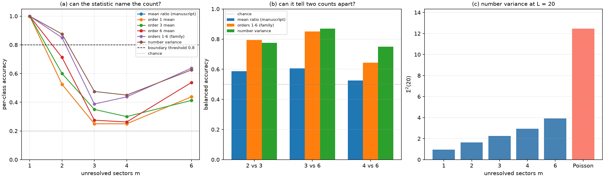

<!--
Riemann Framework
Copyright (C) 2026 MILAN NIKOLIC

This program is free software: you can redistribute it and/or modify
it under the terms of the GNU General Public License as published by
the Free Software Foundation, either version 3 of the License, or
(at your option) any later version.

This program is distributed in the hope that it will be useful,
but WITHOUT ANY WARRANTY; without even the implied warranty of
MERCHANTABILITY or FITNESS FOR A PARTICULAR PURPOSE.  See the
GNU General Public License for more details.

You should have received a copy of the GNU General Public License
along with this program.  If not, see <https://www.gnu.org/licenses/>.
-->

# The boundary map

Three statistics, one classifier, identical spectra. The question: where does each
statistic stop carrying the sector count?

The spectra are the manuscript's generative model with the **total** number of levels held
fixed at 240, so a block has `240 // m` levels. Holding the total fixed is the fair
comparison's precondition: every statistic gets the same number of ratios whatever the
sector count, and the classifier cannot read `m` off the sample size. Training and test
sets are disjoint (80 spectra per class each), and the seed sequence is the same for all
three statistics.

The classifier is a fixed 1-nearest-neighbour on a z-scored feature vector. The **boundary**
of a statistic is the largest sector count whose per-class accuracy reaches `0.8`.

## Results

Per-class accuracy, 1-NN on the full feature vector, 80 + 80 spectra per class:

| statistic | m=1 | m=2 | m=3 | m=4 | m=6 | boundary |
|:---|---:|---:|---:|---:|---:|---:|
| mean ratio (manuscript, order 1) | `1.000` | `0.525` | `0.250` | `0.250` | `0.438` | **1** |
| order 1 mean | `1.000` | `0.525` | `0.250` | `0.250` | `0.438` | 1 |
| order 3 mean | `1.000` | `0.600` | `0.350` | `0.300` | `0.412` | 1 |
| order 6 mean | `1.000` | `0.713` | `0.275` | `0.263` | `0.537` | 1 |
| orders 1 to 6 (family) | `1.000` | `0.850` | `0.388` | `0.438` | `0.637` | **2** |
| number variance `Σ²(L)`, `L = 1..20` | `1.000` | `0.875` | `0.475` | `0.450` | `0.625` | **2** |

Balanced accuracy at telling one count from another, two classes at a time:

| pair | mean ratio | orders 1 to 6 | number variance |
|:---|---:|---:|---:|
| 2 vs 3 | `0.588` | `0.794` | `0.775` |
| 3 vs 6 | `0.606` | `0.850` | `0.869` |
| 4 vs 6 | `0.525` | `0.644` | `0.750` |

Number variance at a window of 20, mean over 40 spectra:

| m | 1 | 2 | 3 | 4 | 6 | Poisson |
|:---|---:|---:|---:|---:|---:|---:|
| `Σ²(20)` | `0.95` | `1.64` | `2.26` | `2.95` | `3.93` | `12.46` |

These reproduce the manuscript's Appendix table: `0.98`, `1.65`, `2.24`, `3.76` and
`12.41` for one, two, three, six sectors and Poisson, within the sampling noise of a
different seed sequence.

## What the map says

**The manuscript's claim is confirmed, and by one number.** The mean ratio's boundary is
one: it is decisive at a single sector and below the threshold at two and above. That is
"the count is not recoverable above two sectors" measured with a single classifier.

**The higher-order family moves the boundary by exactly one step, not further.** With all
six orders the boundary is two; with any single order it is one, which is the interesting
negative result: the family's value is in the *set* of orders, not in any one of them. No
statistic in the map names a count of three, four or six; the best per-class accuracy at
those counts is `0.637`.

**Pairwise separation is a different question, and there the higher orders win.** Told only
to separate three sectors from six, the family reaches `0.850` and the number variance
`0.869`, against `0.606` for the mean ratio. A statistic can separate two counts without
being able to place a spectrum in the full set, and both columns are reported because the
manuscript's Section 8 quotes the pairwise question.

**The number variance separates Poisson from every finite union.** `Σ²(20)` is `12.46` for
Poisson and under `4` for six sectors: a factor of three, and the two never overlap in 40
draws each. This is the comparison the adjacent-gap ratio fails, where Poisson reads
`0.386` and a six-sector union reads `0.392`.

## A qualification the manuscript needs

Section 8 of the manuscript quotes pairwise accuracies of `0.81`, `0.94` and `0.82` for the
family. Those numbers come from the Gaussian naive-Bayes model of Section 2.5, not from the
1-nearest-neighbour classifier used here, which gives `0.79`, `0.85` and `0.64` on the same
features. The difference is the classifier, and it is large enough to matter: the boundary
map should be read as "the ordering of the statistics is robust, the third decimal place is
not, and the absolute accuracy depends on the classifier". A sentence saying so belongs in
the manuscript before the pairwise numbers are compared across documents.

## Limitations

* The spectra are Gaussian blocks of one class. Mixed classes, unequal block sizes and
  physical Hamiltonians are not in this map (they are Goals 2 and 3 of the plan).
* The boundary is defined against a 1-NN classifier and a 0.8 threshold. A different
  classifier moves the accuracies by a few hundredths and can move a boundary by one step
  when an accuracy sits near the threshold (`0.794` for 2 vs 3 is the closest case).
* Twenty training spectra per class would be too few; the map uses 80.
* The histogram of a single order's ratio, which the task specification first proposed as
  the higher-order feature, is *worse* than its mean at these sample sizes: a 30-bin
  histogram over about 240 ratios is dominated by counting noise. The module keeps
  `ratio_histogram` so the comparison is reproducible, and the map uses the means.
